# nimbo and SwiftUI

Each building block of nimbo beside its SwiftUI counterpart, as the gallery shows it live (`cargo run --release --example gallery`, a page per block in its variants). A block aims at its SwiftUI counterpart's behaviour and API shape without copying it 1:1. The pictures are the gallery's, in the light appearance: `make api-shots` makes them and this file again from the gallery's table (`examples/gallery.rs`), so a block changes there.

On macOS SwiftUI's `List` has neither of the grouped styles (`InsetGroupedListStyle` and `GroupedListStyle` are iOS's), so there is no name to take: nimbo's `ListStyle::Grouped` is named after the grouped `Form` (`.formStyle(.grouped)`), whose plates its sections share.

## Layout

### Stacks

SwiftUI: `HStack(spacing: 8) { … }; VStack { … }`

nimbo: `ui.row(Style::new().gap(8.0), |ui| { … }); ui.col(style, |ui| { … })`

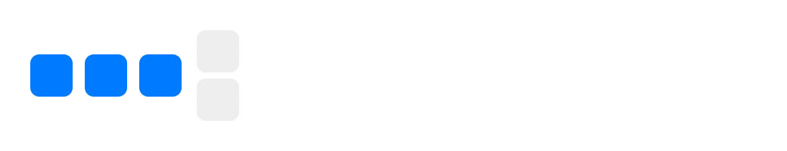

### Grid

SwiftUI: `Grid { GridRow { … } }`

nimbo: `ui.grid(3, Style::new().gap(8.0), |ui| { … })`

### Spacer

SwiftUI: `Spacer()`

nimbo: `ui.spacer()`

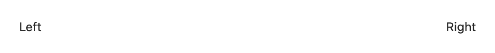

### Divider

SwiftUI: `Divider()`

nimbo: `ui.divider()`

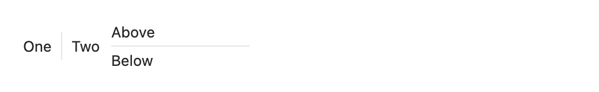

### Scroll view

SwiftUI: `ScrollView(.vertical) { … }`

nimbo: `ui.scroll_area(Style::new().h(px(80.0)).scroll(Axes::VERTICAL), |ui| { … })`

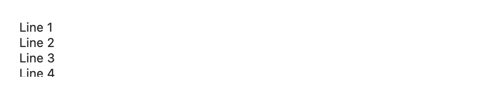

### Overlay

SwiftUI: `.overlay(alignment: .topTrailing) { … }`

nimbo: `ui.float(Float::parent().attach(UnitPoint::TOP_TRAILING).anchor(UnitPoint::TOP_TRAILING)).el(style)`

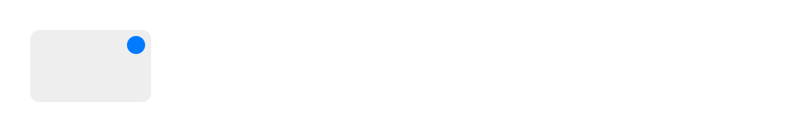

## Text

### Text

SwiftUI: `Text("Title").font(.headline).foregroundStyle(.secondary)`

nimbo: `ui.text("Title", TextStyle::new(t.bold, t.muted))`

### Line limit

SwiftUI: `Text(path).lineLimit(1).truncationMode(.middle)`

nimbo: `ui.text(path, t.body().line_limit(1).truncation(TruncationMode::Middle))`

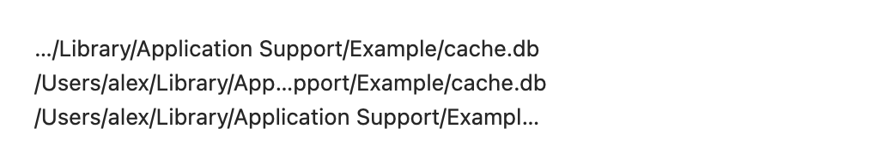

### Underline

SwiftUI: `Text("WER").underline(pattern: .dot)`

nimbo: `ui.text("WER", s.underline(LinePattern::Dot)); s.strikethrough(LinePattern::Solid)`

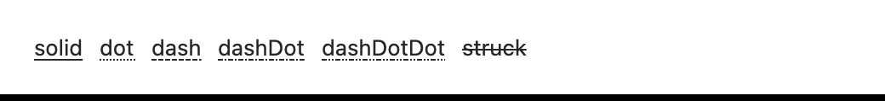

### Selectable text

SwiftUI: `Text(log).textSelection(.enabled)`

nimbo: `ui.selectable(&log)`

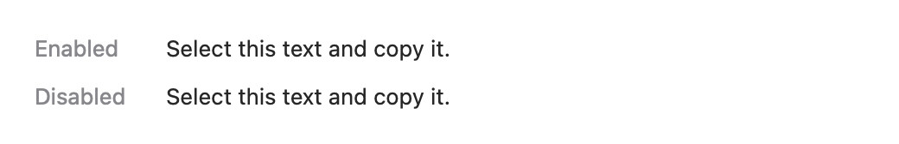

### Link

SwiftUI: `Link("Learn more", destination: url)`

nimbo: `if ui.link("Learn more…").clicked { nimbo::open::url(URL)? }`

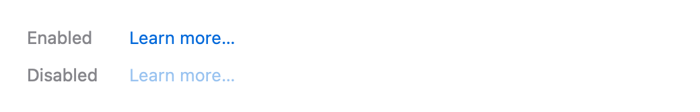

### Image

SwiftUI: `Image(systemName: "gear")`

nimbo: `ui.icon(Icon::GEAR, 20.0, t.text)`

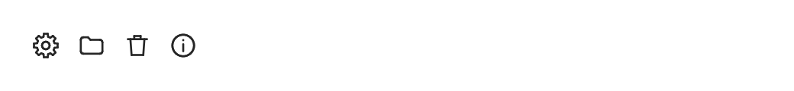

## Controls

### Button

SwiftUI: `Button("Save") { … }.buttonStyle(.borderedProminent)`

nimbo: `Button::new("Save").style(ButtonStyle::BorderedProminent).show(ui)`

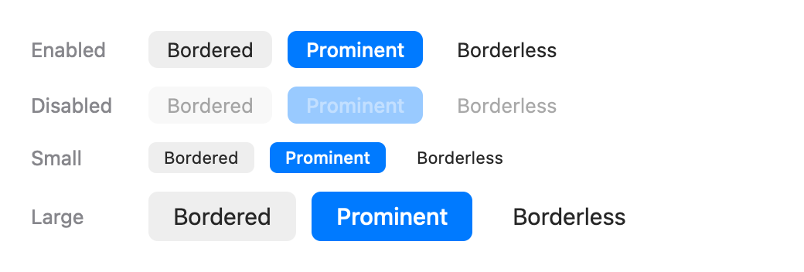

### Button role

SwiftUI: `Button("Delete", role: .destructive) { … }`

nimbo: `Button::new("Delete").role(ButtonRole::Destructive).show(ui)`

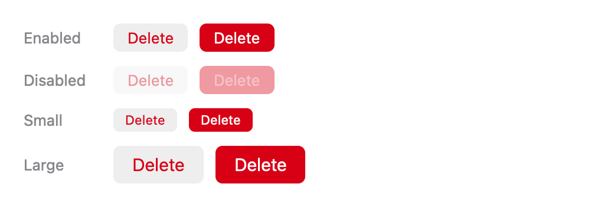

### Icon button

SwiftUI: `Button { Image(systemName: "trash") }.buttonStyle(.borderless)`

nimbo: `ui.icon_button(Icon::TRASH)`

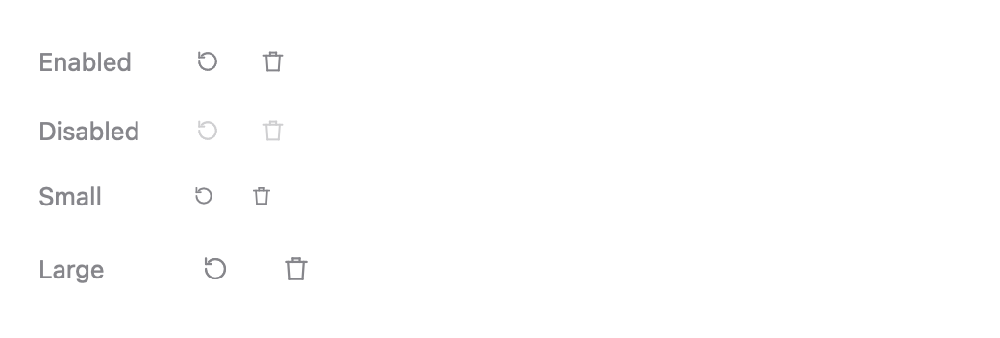

### Switch

SwiftUI: `Toggle("Live", isOn: $live)`

nimbo: `ui.toggle(&mut self.live, "Live")`

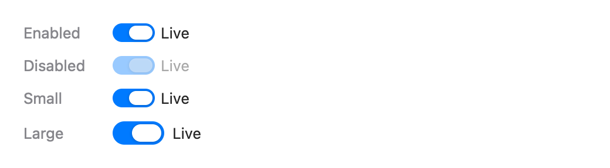

### Check box

SwiftUI: `Toggle("Wrap", isOn: $wrap).toggleStyle(.checkbox)`

nimbo: `ui.checkbox(&mut self.wrap, "Wrap")`

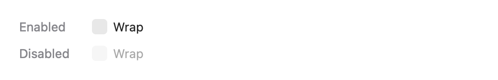

### Slider

SwiftUI: `Slider(value: $zoom, in: 0...200)`

nimbo: `ui.slider(&mut self.zoom, 0.0..=200.0)`

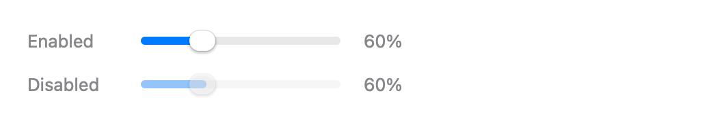

### Picker

SwiftUI: `Picker("Size", selection: $size) { …; Divider(); … }`

nimbo: `Picker::new(&mut self.size).options(&A).divider().options(&B).show(ui)`

### Segmented picker

SwiftUI: `Picker(…) { … }.pickerStyle(.segmented)`

nimbo: `ui.segmented(&mut self.view, &[(0, "List"), (1, "Grid")])`

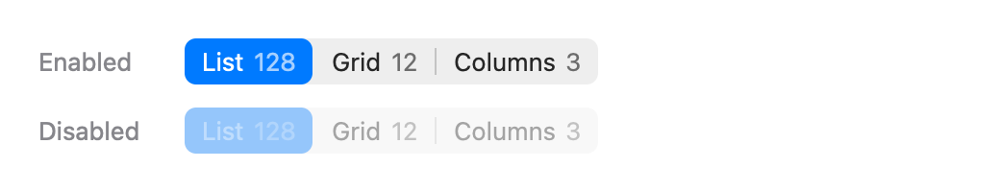

### Text field

SwiftUI: `TextField("Name", text: $name)`

nimbo: `ui.field(&mut self.name, "Name")`

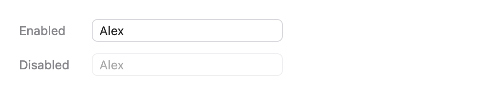

### Secure field

SwiftUI: `SecureField("Password", text: $key)`

nimbo: `ui.password_field(&mut self.key, "Password")`

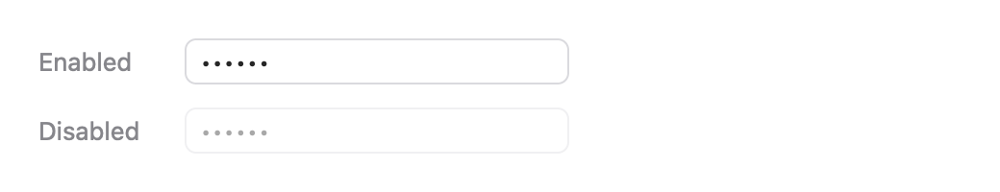

### Search field

SwiftUI: `.searchable(text: $query)`

nimbo: `ui.search(&mut self.query, "Search")`

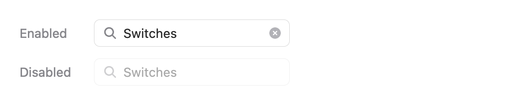

### Progress

SwiftUI: `ProgressView(value: 0.42)`

nimbo: `ui.progress(Some(0.42))`

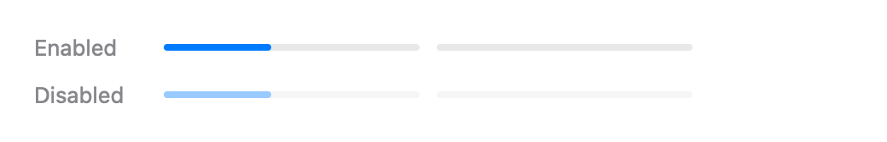

### Spinner

SwiftUI: `ProgressView()`

nimbo: `ui.spinner()`

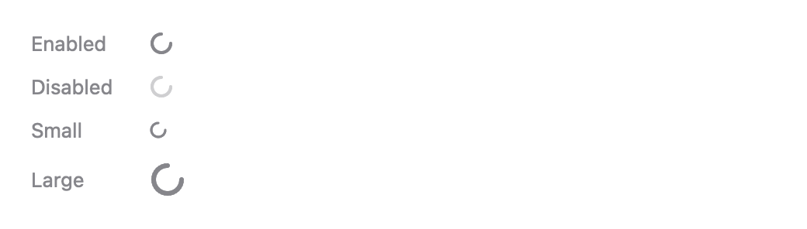

### Badge

SwiftUI: `.badge("New")`

nimbo: `ui.badge("New", Tone::Accent)`

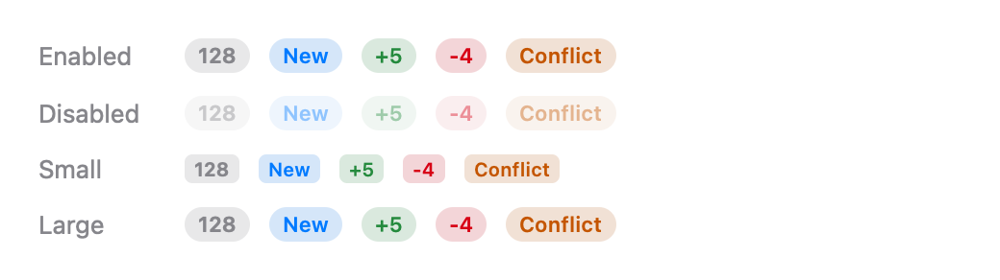

### Shortcut recorder

SwiftUI: `KeyboardShortcut (SwiftUI has no recorder)`

nimbo: `ui.shortcut(&mut self.hotkey)`

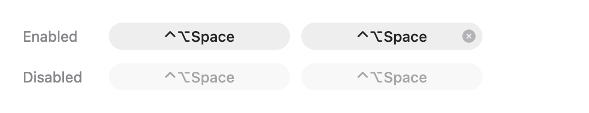

### Help marks

SwiftUI: `Image(systemName: "info.circle").help(tip); HelpLink { … }`

nimbo: `ui.help(tip).info_button(); ui.help(why).warning_button(); ui.help_button()`

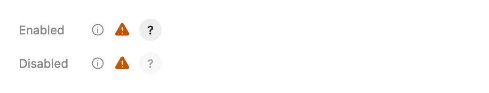

## Form

### Section

SwiftUI: `Section { … } header: { … } footer: { … }`

nimbo: `ui.form_section(&fs, Section::new(header).footer("…"), |ui| { … })`

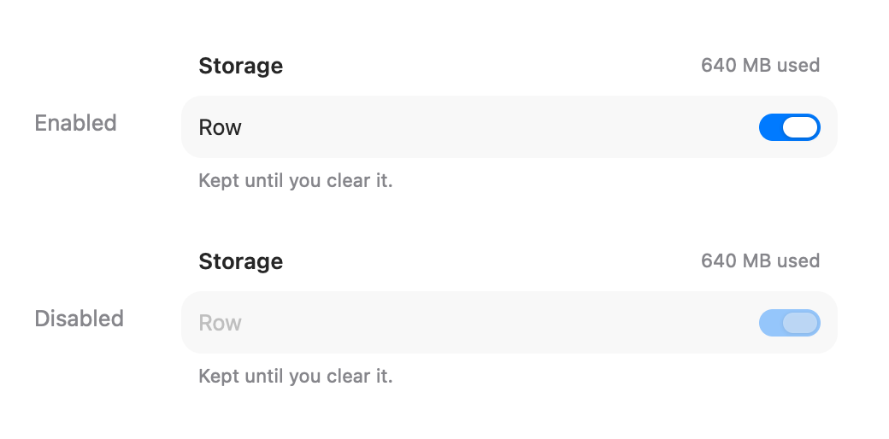

### Form row

SwiftUI: `LabeledContent { Toggle(…) } label: { Text(title); Text(subtitle) }`

nimbo: `ui.form_row(&fs, FormRow::new("Open at login").caption("…"), |ui| ui.toggle(&mut on, ""))`

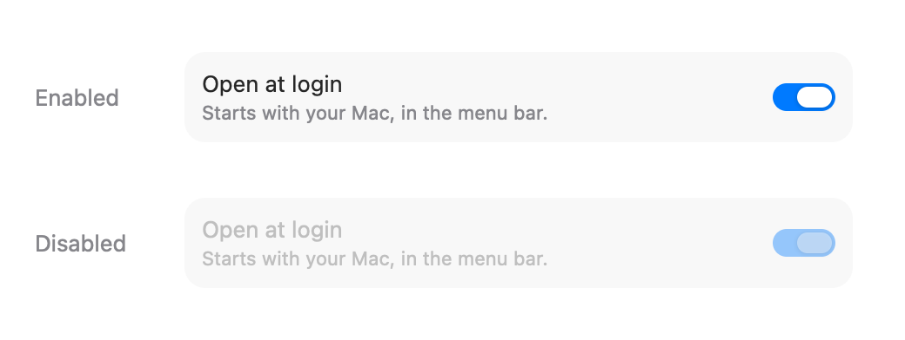

### Composed label

SwiftUI: `label: { Text(name); Text("New").badge(…) }`

nimbo: `FormRow::new(|ui: &mut Ui, s: TextStyle| { ui.text(name, s); ui.control_size(ControlSize::Small).badge("New", Tone::Accent); })`

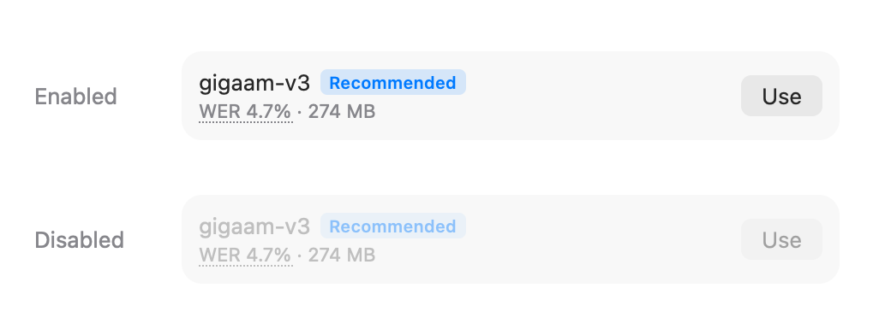

### Row tile

SwiftUI: `Label { Text(title) } icon: { Image(systemName: "folder") }`

nimbo: `FormRow::new("Data").tile(Icon::FOLDER)`

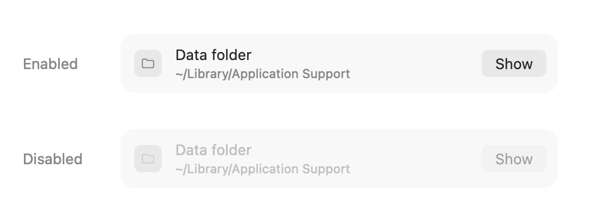

### Disclosure

SwiftUI: `DisclosureGroup("Other models") { … }`

nimbo: `ui.form_disclosure(&fs, FormRow::new("Other models"), |ui| { … })`

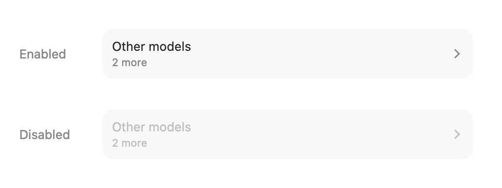

### Footer

SwiftUI: `HelpLink { … } at a pane's end`

nimbo: `ui.help("Help").form_footer(&fs, |ui| _ = ui.button("Reset All…"))`

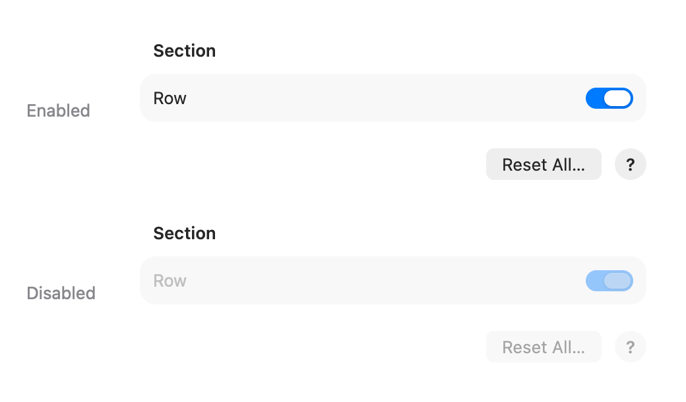

## List

### List

SwiftUI: `List(items, selection: $sel) { … }`

nimbo: `List::new(n, 24.0).selection(&mut sel).show(ui, |ui, row| { … })`

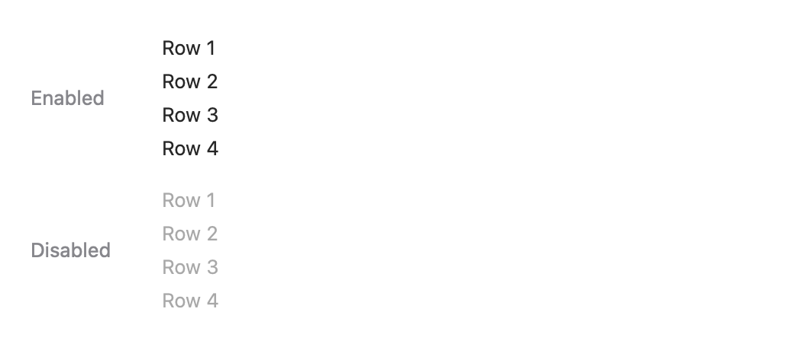

### List sections

SwiftUI: `Section(header:) in a List; .listStyle(…)`

nimbo: `List::new(n, 32.0).sections(&starts, 24.0, &head).list_style(ListStyle::Grouped)`

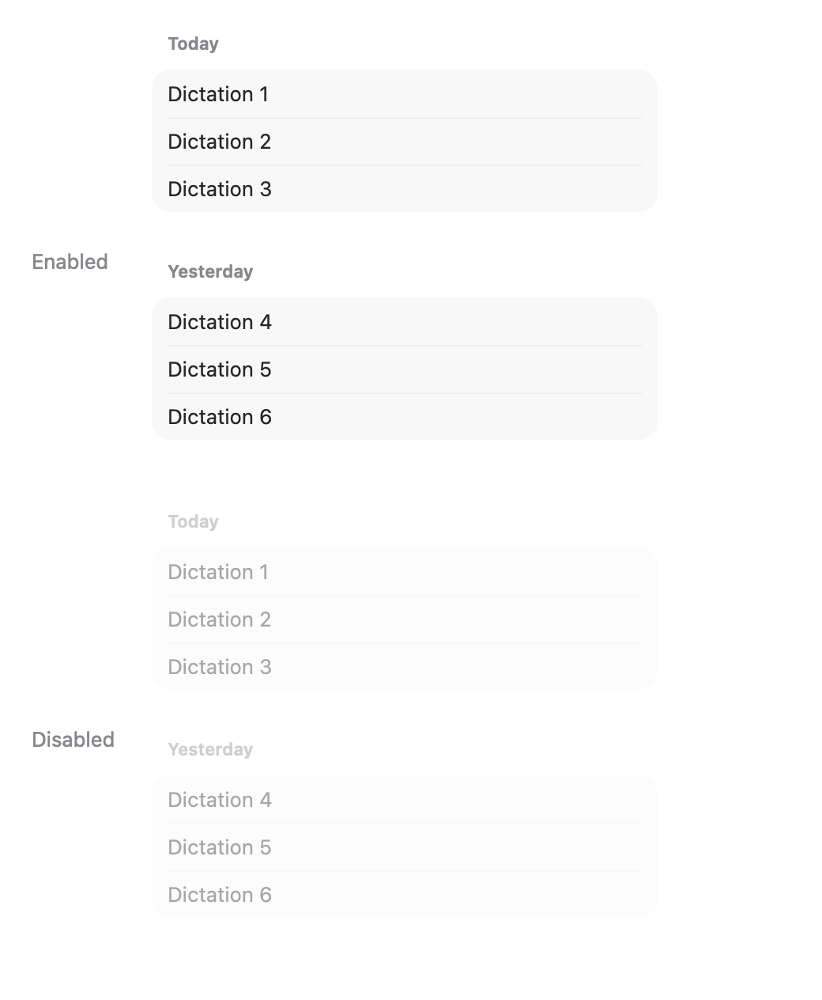

## Containers

### Tabs

SwiftUI: `TabView { … }`

nimbo: `Tabs::new(&mut self.tab, &["One", "Two"]).show(ui, |ui, i| { … })`

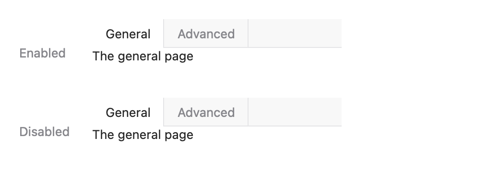

### Split

SwiftUI: `HSplitView { … }`

nimbo: `Split::new(Axis::Horizontal).ratio(&mut self.side).show(ui, |ui, pane| { … })`

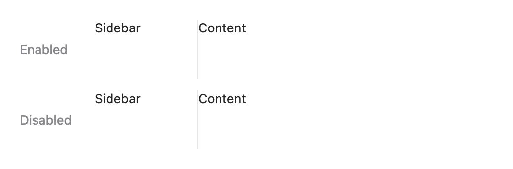

### Menu

SwiftUI: `Menu("Actions") { Button(…) }`

nimbo: `ui.menu("Actions", |ui| { ui.menu_item("Copy"); })`

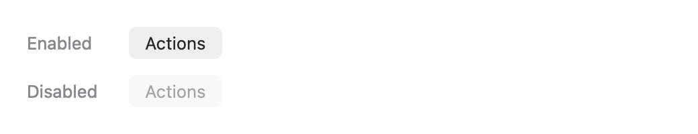

### Lazy column

SwiftUI: `LazyVStack { ForEach(…) }`

nimbo: `ui.virtual_col(heights, |i| i, |ui, i| { … })`

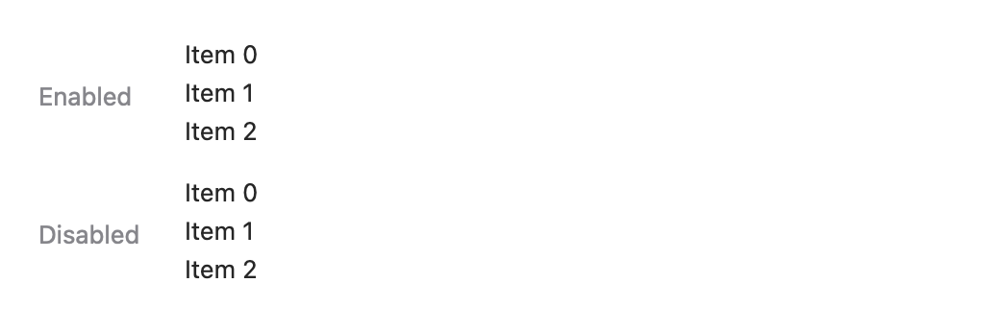

## Presentation

### Alert

SwiftUI: `.alert("Delete?", isPresented: $ask) { Button("Delete", role: .destructive) }`

nimbo: `Dialog::new("Delete?").button("Delete", ButtonRole::Destructive).show(ui, &mut self.ask)`

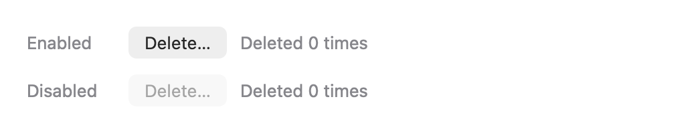

### Context menu

SwiftUI: `.contextMenu { Button("Copy") { … } }`

nimbo: `ui.context_menu(r.id, || Menu::new(vec![Item::button(Action::Copy, "Copy")]))`

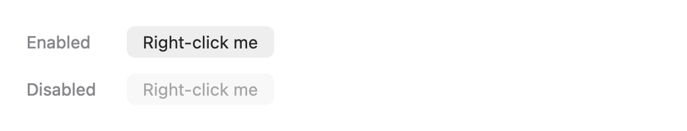

### Tooltip

SwiftUI: `.help("Saves it")`

nimbo: `ui.help("Saves it").button("Save")`

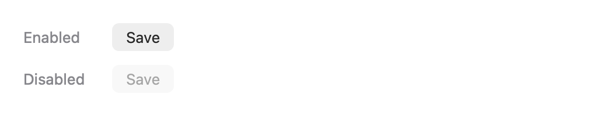

## Modifiers

### Disabled

SwiftUI: `.disabled(true)`

nimbo: `ui.disabled(true).col(Style::new(), |ui| { … })`

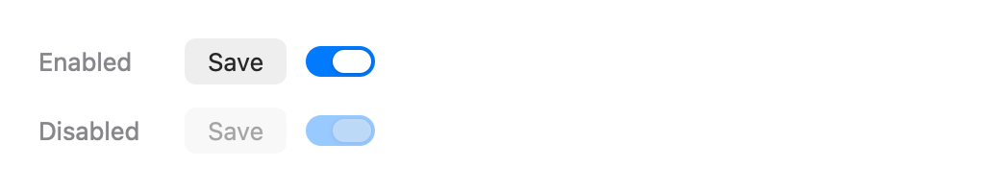

### Control size

SwiftUI: `.controlSize(.small)`

nimbo: `ui.control_size(ControlSize::Small).row(Style::new(), |ui| { … })`

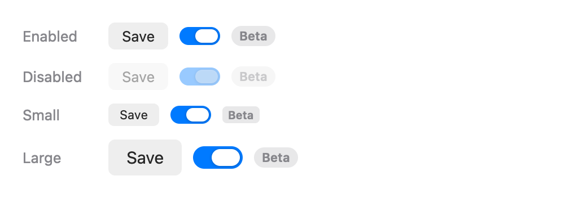

### Accessibility label

SwiftUI: `.accessibilityLabel("Reset")`

nimbo: `ui.a11y_label("Reset").icon_button(Icon::RESET)`

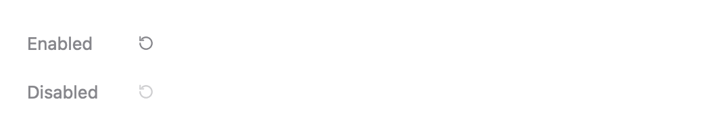

### Keyboard shortcut

SwiftUI: `.keyboardShortcut("z", modifiers: .command)`

nimbo: `ui.keymap(&[bind(Shortcut::char('z').cmd(), Command::Undo)]).col(…)`

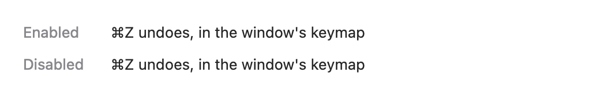
