# nimbo and SwiftUI

Each building block of nimbo beside its SwiftUI counterpart, as the gallery shows it live (`cargo run --release --example gallery`, a page per block in its variants). A block aims at its SwiftUI counterpart's behaviour and API shape without copying it 1:1. The pictures are the gallery's, in the light appearance, kept on the repo's `assets` branch: `make api-shots` makes them and this file again from the gallery's table (`examples/gallery/blocks.rs`), so a block changes there.

On macOS SwiftUI's `List` has neither of the grouped styles (`InsetGroupedListStyle` and `GroupedListStyle` are iOS's): nimbo's `InsetGroupedListStyle` takes the iOS name for the plates of the grouped `Form` (`.formStyle(.grouped)`), which its sections share.

## Layout

### Stacks

SwiftUI: `HStack(spacing: 8) { … }; VStack { … }`

nimbo: `ui.row(Style::new().gap(8.0), |ui| { … }); ui.col(style, |ui| { … })`

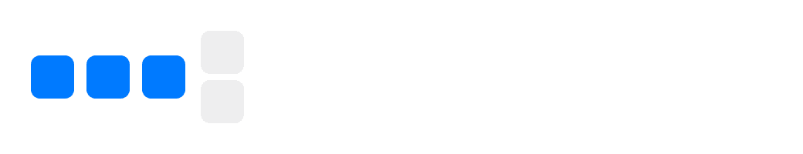

### Grid

SwiftUI: `Grid { GridRow { … } }`

nimbo: `ui.grid(3, Style::new().gap(8.0), |ui| { … })`

### Spacer

SwiftUI: `Spacer()`

nimbo: `ui.spacer()`

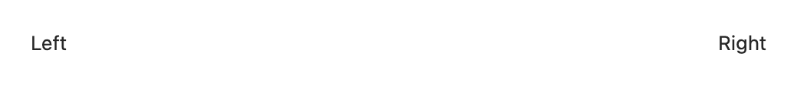

### Divider

SwiftUI: `Divider()`

nimbo: `ui.divider()`

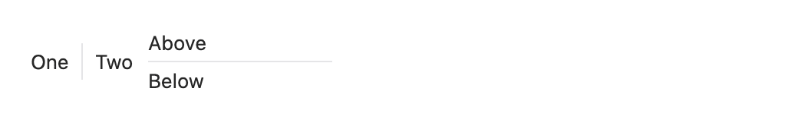

### Scroll view

SwiftUI: `ScrollView(.vertical) { … }`

nimbo: `ui.scroll_area(Style::new().h(px(80.0)).scroll(Axes::VERTICAL), |ui| { … })`

### Overlay

SwiftUI: `.overlay(alignment: .topTrailing) { … }`

nimbo: `ui.float(Float::parent().attach(UnitPoint::TOP_TRAILING).anchor(UnitPoint::TOP_TRAILING)).el(style)`

## Text

### Text

SwiftUI: `Text("Title").font(.headline).foregroundStyle(.secondary)`

nimbo: `ui.text("Title", TextStyle::new(t.bold(), t.secondary()))`

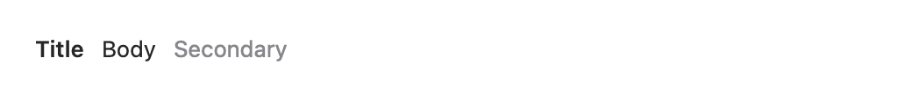

### Localized text

SwiftUI: `Text("Keep the history"); String(localized: "\(name) is not on disk")`

nimbo: `ui.text(t!("Keep the history"), s); t!("{name} is not on disk", name); tn!("{n} file", "{n} files", count)`

### Line limit

SwiftUI: `Text(path).lineLimit(1).truncationMode(.middle)`

nimbo: `ui.text(path, t.body().line_limit(1).truncation(TruncationMode::Middle))`

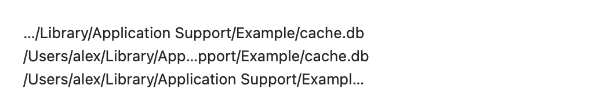

### Underline

SwiftUI: `Text("WER").underline(pattern: .dot)`

nimbo: `ui.text("WER", s.underline(LinePattern::Dot)); s.strikethrough(LinePattern::Solid)`

### Selectable text

SwiftUI: `Text(log).textSelection(.enabled)`

nimbo: `ui.selectable_text(&log, t.body())`

### Link

SwiftUI: `Link("Learn more", destination: url)`

nimbo: `if ui.link("Learn more…").clicked { nimbo::open::url(URL)? }`

### Image

SwiftUI: `Image(systemName: "gear")`

nimbo: `ui.icon(Icon::GEAR, 20.0, t.text())`

### Label content

SwiftUI: `Label { Text(title) } icon: { Image(systemName: "folder") }; configuration.label in a style`

nimbo: `let label: Content = Icon::FOLDER.into(); label.build(ui.with_id(id.key("label")), t.label())`

### Photo

SwiftUI: `Image(nsImage: NSImage(data: file)!).resizable().aspectRatio(contentMode: .fill).frame(width: 80, height: 80).clipped()`

nimbo: `let photo = Bitmap::decode(&file, 240)?; ui.aspect_ratio(ContentMode::Fill).image(&photo, Style::new().w(px(80.0)).h(px(80.0)))`

## Controls

### Button

SwiftUI: `Button("Save") { … }.buttonStyle(.borderedProminent)`

nimbo: `ui.button_style(&BorderedProminentButtonStyle).button("Save")`

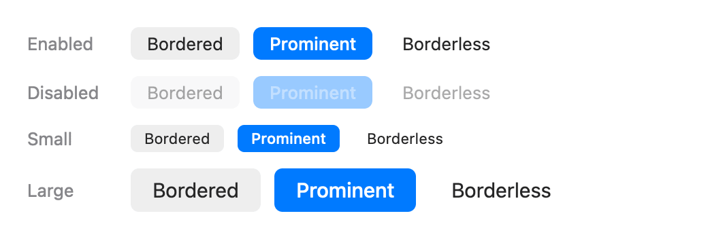

### Button role

SwiftUI: `Button("Delete", role: .destructive) { … }`

nimbo: `Button::new("Delete").role(ButtonRole::Destructive).show(ui)`

### Icon button

SwiftUI: `Button { Image(systemName: "trash") }.buttonStyle(.borderless)`

nimbo: `ui.icon_button(Icon::TRASH)`

### Button style

SwiftUI: `HStack { Button("Cut") { … }; Button("Copy") { … } }.buttonStyle(.borderless)`

nimbo: `ui.button_style(&BorderlessButtonStyle).row(style, |ui| { ui.button("Cut"); ui.button("Copy"); }); ui.button("Paste")`

### Custom button style

SwiftUI: `struct Pill: ButtonStyle { func makeBody(configuration: Configuration) -> some View { configuration.label.padding(…).background(…) } }`

nimbo: `impl ButtonStyle for Pill { fn make_body(&self, ui: &mut Ui, mut c: ButtonConfiguration) { ui.row(style, |ui| c.label(ui, s)); } } ui.button_style(&Pill).button("Pill")`

### Switch

SwiftUI: `Toggle("Live", isOn: $live)`

nimbo: `ui.toggle(&mut self.live, "Live")`

### Check box

SwiftUI: `Toggle("Wrap", isOn: $wrap).toggleStyle(.checkbox)`

nimbo: `ui.toggle_style(&CheckboxToggleStyle).toggle(&mut self.wrap, "Wrap")`

### Button toggle

SwiftUI: `Toggle("Bold", isOn: $bold).toggleStyle(.button)`

nimbo: `ui.toggle_style(&ButtonToggleStyle).toggle(&mut self.bold, "Bold")`

### Toggle style

SwiftUI: `VStack { Toggle("Wrap", …); Toggle("Numbers", …) }.toggleStyle(.checkbox)`

nimbo: `ui.toggle_style(&CheckboxToggleStyle).col(style, |ui| { ui.toggle(&mut self.wrap, "Wrap"); ui.toggle(&mut self.numbers, "Numbers"); }); ui.toggle(&mut self.live, "Live")`

### Custom toggle style

SwiftUI: `struct Dot: ToggleStyle { func makeBody(configuration: Configuration) -> some View { HStack { Circle()…; configuration.label } } }`

nimbo: `impl ToggleStyle for Dot { fn make_body(&self, ui: &mut Ui, mut c: ToggleConfiguration) { ui.row(style, |ui| { ui.el(dot(c.is_on())); c.label(ui, s); }); } } ui.toggle_style(&Dot).toggle(&mut self.live, "Live"); ui.toggle_style(&PlainToggleStyle).toggle(&mut self.wrap, "Plain")`

### Slider

SwiftUI: `Slider(value: $zoom, in: 0...200)`

nimbo: `ui.slider(&mut self.zoom, 0.0..=200.0)`

### Slider steps

SwiftUI: `Slider(value: $level, in: 10...90, step: 10) { … } tick: { v in SliderTick(v) { … } }`

nimbo: `Slider::new(&mut self.level, 10.0..=90.0).step(10.0).tick_label(|v| (v == 50.0).then(|| "50%".into())).show(ui)`

### Slider style

SwiftUI: `Slider(value: $zoom, in: 0...200) (SwiftUI has no slider style)`

nimbo: `ui.slider_style(&PlainSliderStyle).col(style, |ui| { ui.slider(&mut self.zoom, 0.0..=200.0); }); ui.slider(&mut self.zoom, 0.0..=200.0)`

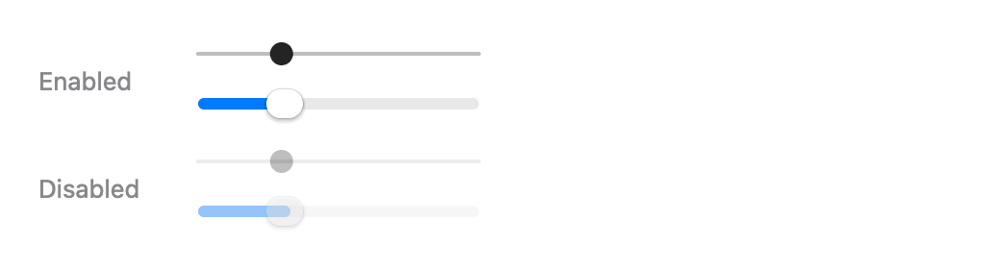

### Custom slider style

SwiftUI: `struct Meter: ProgressViewStyle { … } (SwiftUI has no slider style)`

nimbo: `impl SliderStyle for Meter { fn make_body(&self, ui: &mut Ui, c: SliderConfiguration) { let k = c.fraction(); c.root(ui).canvas(style, move |f, r| { … }); } } Slider::new(&mut self.level, 10.0..=90.0).step(10.0).show(ui.slider_style(&Meter))`

### Picker

SwiftUI: `Picker("Size", selection: $size) { …; Divider(); … }`

nimbo: `Picker::new(&mut self.size).options(&A).divider().options(&B).show(ui)`

### Segmented picker

SwiftUI: `Picker(…) { … }.pickerStyle(.segmented)`

nimbo: `ui.picker_style(&SegmentedPickerStyle).picker(&mut self.view, &[Tag::new(0, "List").count(128), Tag::new(1, "Grid")])`

### Picker style

SwiftUI: `VStack { Picker(…) { … } }.pickerStyle(.inline); Picker(…) { … }`

nimbo: `ui.picker_style(&InlinePickerStyle).row(style, |ui| _ = ui.picker(&mut self.size, &SIZES)); ui.picker(&mut self.size, &SIZES)`

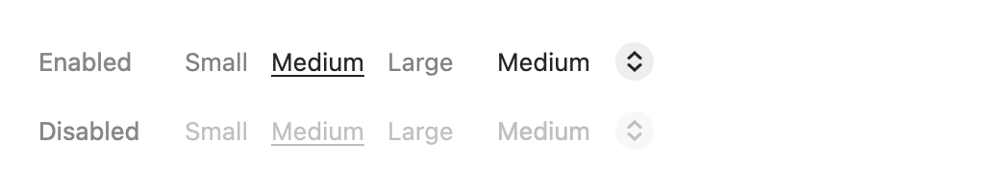

### Custom picker style

SwiftUI: `struct Chips: PickerStyle (SwiftUI's is closed: its styles are the system's)`

nimbo: `impl PickerStyle for Chips { fn make_body(&self, ui: &mut Ui, mut c: PickerConfiguration) { let b = c.segments(ui); ui.row(style, |ui| for i in 0..c.len() { ui.with_id(c.item_id(i)).row(b.pointer(chip), |ui| ui.text(c.label(i), s)); }); } } ui.picker_style(&Chips).picker(&mut self.view, &VIEWS)`

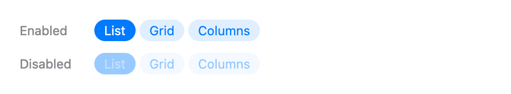

### Text field

SwiftUI: `TextField("Name", text: $name)`

nimbo: `ui.text_field(&mut self.name, "Name")`

### Multi-line field

SwiftUI: `TextField("Notes", text: $notes, axis: .vertical)`

nimbo: `TextField::new(&mut self.notes, "Notes").axis(Axis::Vertical).show(ui)`

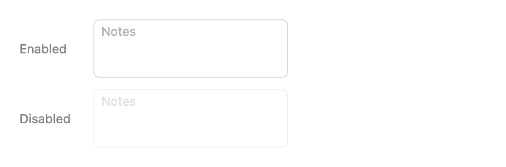

### Secure field

SwiftUI: `SecureField("Password", text: $key)`

nimbo: `ui.secure_field(&mut self.key, "Password")`

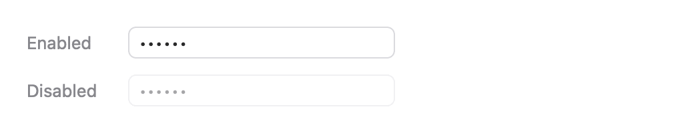

### Search field

SwiftUI: `.searchable(text: $query)`

nimbo: `ui.search_field(&mut self.query, "Search")`

### Text field style

SwiftUI: `VStack { TextField("Name", text: $name); TextField("City", text: $city) }.textFieldStyle(.plain)`

nimbo: `ui.text_field_style(&PlainTextFieldStyle).col(style, |ui| { ui.text_field(&mut self.name, "Name"); ui.text_field(&mut self.city, "City"); }); ui.text_field(&mut self.email, "E-mail")`

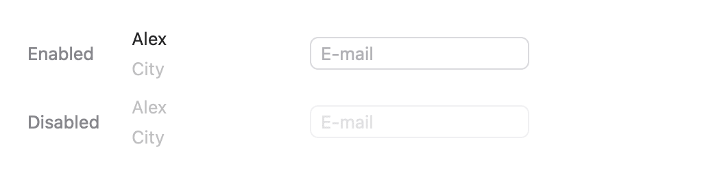

### Custom text field style

SwiftUI: `struct Underline: TextFieldStyle { func _body(configuration: TextField<_Label>) -> some View { configuration.padding(…).overlay(alignment: .bottom) { … } } }`

nimbo: `impl TextFieldStyle for Underline { fn make_body(&self, ui: &mut Ui, mut c: TextFieldConfiguration) { ui.row(style.scroll(c.axis().into()), |ui| c.text(ui, &fs)); } } ui.text_field_style(&Underline).text_field(&mut self.city, "City")`

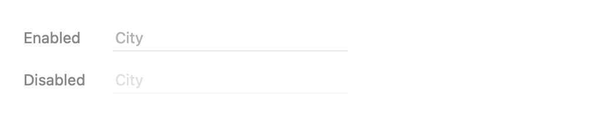

### Progress

SwiftUI: `ProgressView(value: 0.42)`

nimbo: `ui.progress(Some(0.42))`

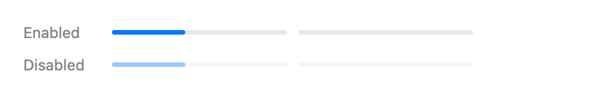

### Spinner

SwiftUI: `ProgressView()`

nimbo: `ui.spinner()`

### Badge

SwiftUI: `.badge("New")`

nimbo: `ui.badge("New", Tone::Accent)`

### Hotkey recorder

SwiftUI: `KeyboardShortcut (SwiftUI has no recorder)`

nimbo: `ui.hotkey_recorder(&mut self.hotkey)`

### Control behavior

SwiftUI: `Button(action:) { … }.buttonStyle(MyStyle()), a look of the app's own`

nimbo: `let b = ui.button_behavior(id); ui.control(&b).canvas(style, move |f, r| { … }); if b.clicked { … }`

### Help marks

SwiftUI: `Image(systemName: "info.circle").help(tip); HelpLink { … }`

nimbo: `ui.help(tip).info_button(); ui.help(why).warning_button(); ui.help_button()`

## Form

### Section

SwiftUI: `Section { … } header: { … } footer: { … }`

nimbo: `ui.form_section(&fs, Section::new(header).footer("…"), |ui| { … })`

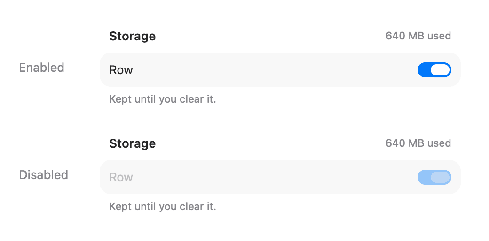

### Form row

SwiftUI: `LabeledContent { Toggle(isOn: $on) {} } label: { Text(title); Text(subtitle) }`

nimbo: `ui.form_row(&fs, FormRow::new("Open at login").caption("…"), |ui| ui.toggle(&mut on, ()))`

### Composed label

SwiftUI: `label: { Text(name); Text("New").badge(…) }`

nimbo: `FormRow::new(|ui: &mut Ui, s: TextStyle| { ui.text(name, s); ui.control_size(ControlSize::Small).badge("New", Tone::Accent); })`

### Row tile

SwiftUI: `Label { Text(title) } icon: { Image(systemName: "folder") }`

nimbo: `FormRow::new("Data").tile(Icon::FOLDER)`

### Row footer

SwiftUI: `Section { VStack { Toggle(…); Slider(…) } }`

nimbo: `FormRow::new("Turn off below 30%").footer(|ui: &mut Ui, _: TextStyle| _ = ui.slider(&mut level, 10.0..=90.0))`

### Disclosure

SwiftUI: `DisclosureGroup("Other models") { … }`

nimbo: `ui.form_disclosure(&fs, FormRow::new("Other models"), |ui| { … })`

### Toolbar tabs

SwiftUI: `TabView(selection: $page) { General().tabItem { Label("General", systemImage: "gear") }.tag(Page.general) } in a Settings scene`

nimbo: `ui.toolbar_tabs(&fs, &mut self.page, &[Tag::new(Page::General, "General").icon(Icon::GEAR), Tag::new(Page::About, "About").icon(Icon::INFO)])`

### Footer

SwiftUI: `HelpLink { … } at a pane's end`

nimbo: `ui.help("Help").form_footer(&fs, |ui| _ = ui.button("Reset All…"))`

## List

### List

SwiftUI: `List(items, selection: $sel) { … }`

nimbo: `List::new(n, 24.0).selection(&mut sel).show(ui, |ui, row| { … })`

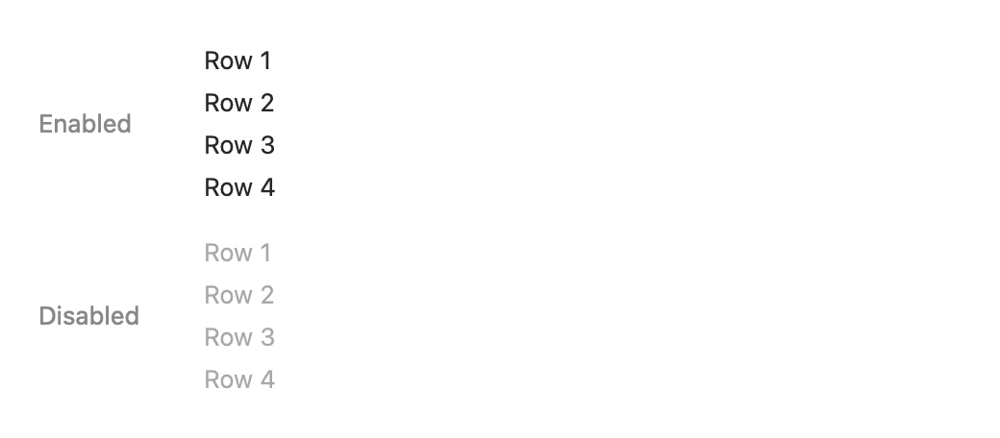

### List sections

SwiftUI: `Section(header:) in a List; .listStyle(…)`

nimbo: `List::new(n, 32.0).sections(&starts, 24.0, &head).show(ui.list_style(&InsetGroupedListStyle), |ui, row| { … })`

### List style

SwiftUI: `List(items, selection: $sel) { … }.listStyle(.plain)`

nimbo: `list.show(ui.list_style(&PlainListStyle), |ui, row| { … }); InsetListStyle by default, InsetGroupedListStyle`

### Custom list style

SwiftUI: `struct Stripes: ListStyle (SwiftUI's has no public makeBody)`

nimbo: `impl ListStyle for Stripes { fn make_body<'a>(&self, ui: &mut Ui<'a>, mut c: ListConfiguration<'_, 'a>) { ui.scroll_area(c.frame(), |ui| c.rows(ui, |ui, mut r| _ = ui.row(r.frame().bg(fill), |ui| r.content(ui)))); } }`

### List behavior

SwiftUI: `List(rows, selection: $sel) { … }.listRowBackground(…)`

nimbo: `let b = ui.list_behavior(id, ListRows::new(n, 22.0), &mut sel, &key); ui.with_id(id).scroll_area(b.style(style), |ui| ui.list_rows(&b, |ui, i, k| { … }))`

## Containers

### Tabs

SwiftUI: `TabView { … }`

nimbo: `Tabs::new(&mut self.tab, &["One", "Two"]).show(ui, |ui, i| { … })`

### Split

SwiftUI: `HSplitView { … }`

nimbo: `Split::new(Axis::Horizontal).ratio(&mut self.side).show(ui, |ui, pane| { … })`

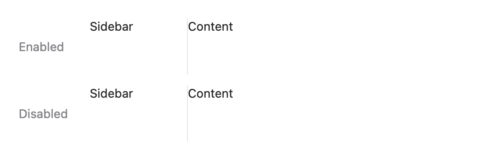

### Navigation split

SwiftUI: `NavigationSplitView { … } detail: { … }`

nimbo: `Split::navigation().ratio(&mut self.side).show(ui, |ui, pane| { … })`

### Toolbar

SwiftUI: `Detail().toolbar { ToolbarItem(placement: .principal) { … }; ToolbarItem(placement: .primaryAction) { … } } in a NavigationSplitView`

nimbo: `ui.toolbar(|ui| ui.toolbar_item(ToolbarItemPlacement::PrimaryAction, |ui| _ = ui.icon_button(Icon::DOC))) in a column`

### Unified toolbar

SwiftUI: `.windowToolbarStyle(.unified)`

nimbo: `ui.window_toolbar_style(WindowToolbarStyle::Unified); ui.row(band, |ui| { … }) at the window's top`

### Menu

SwiftUI: `Menu("Actions") { Button(…) }`

nimbo: `ui.menu("Actions", |ui| { ui.menu_item("Copy"); })`

### Lazy column

SwiftUI: `LazyVStack { ForEach(…) }`

nimbo: `ui.virtual_col(heights, |i| i, |ui, i| { … })`

### Scroll behavior

SwiftUI: `ScrollView { … }.scrollIndicators(.hidden).onScrollGeometryChange(…) { … }`

nimbo: `let b = ui.scroll_behavior(id, Axes::VERTICAL); ui.with_id(id).col(style.scroll(Axes::VERTICAL), |ui| { …; if let Some(bar) = b.bar(Axis::Vertical) { ui.with_id(b.thumb(Axis::Vertical)).float(at).el(knob) } })`

### Scroll indicators

SwiftUI: `NSScroller.knobStyle = .light (AppKit; SwiftUI has none)`

nimbo: `ui.set_environment(Some(ScrollerKnob { color: red, ..ScrollerKnob::DARK })); ui.scroll_area(style, |ui| { … })`

### Stack queries

SwiftUI: `Divider() follows its stack's axis (SwiftUI has no API for it)`

nimbo: `let line = match ui.parent_axis() { Some(Axis::Horizontal) => v, _ => h }; ui.child_count() == 0`

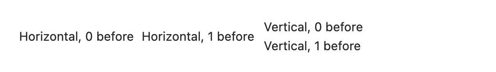

## Presentation

### Alert

SwiftUI: `.alert("Delete?", isPresented: $ask) { Button("Delete", role: .destructive) }`

nimbo: `Dialog::new("Delete?").button("Delete", ButtonRole::Destructive).show(ui, &mut self.ask)`

### Context menu

SwiftUI: `.contextMenu { Button("Copy") { … } }`

nimbo: `ui.context_menu(r.id, || Menu::new(vec![Item::button(Action::Copy, "Copy")])); match ui.native_menu(id, at, menu) { NativeMenu::Unavailable => /* draw it */, NativeMenu::Unanswered => {}, NativeMenu::Answered(a) => … }`

### Menu bar

SwiftUI: `.commands { CommandMenu("Track") { Button("Play") { … } }; CommandGroup(replacing: .newItem) { … } }`

nimbo: `main.set_commands(&Commands::new().menu("Track", Menu::new(vec![Item::button(Act::Play, "Play")])).replacing(CommandGroupPlacement::NewItem, items), |main, act| …)`

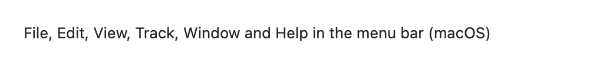

### Tooltip

SwiftUI: `.help("Saves it")`

nimbo: `ui.help("Saves it").button("Save"); ui.help_style(&PlainHelpStyle) for the window, TooltipHelpStyle by default`

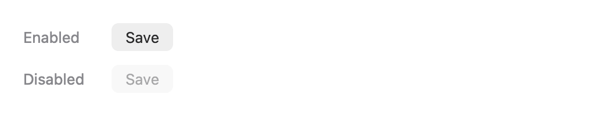

### Custom help style

SwiftUI: `.help("Saves it") (SwiftUI has no help style)`

nimbo: `impl HelpStyle for Note { fn make_body(&self, ui: &mut Ui, c: HelpConfiguration) { ui.row(style.opacity(c.opacity()), |ui| ui.text(c.text(), s)); } } ui.help_style(&Note)`

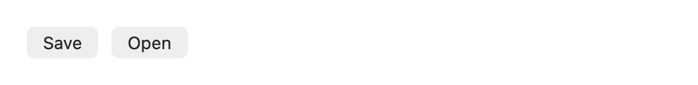

## Modifiers

### Disabled

SwiftUI: `.disabled(true)`

nimbo: `ui.disabled(true).col(Style::new(), |ui| { … })`

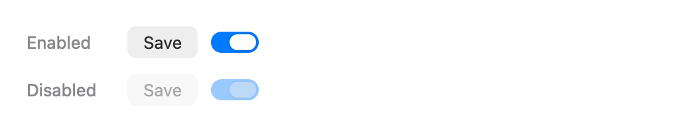

### Control size

SwiftUI: `.controlSize(.small)`

nimbo: `ui.control_size(ControlSize::Small).row(Style::new(), |ui| { … })`

### Accessibility label

SwiftUI: `.accessibilityLabel("Reset")`

nimbo: `ui.a11y_label("Reset").icon_button(Icon::RESET)`

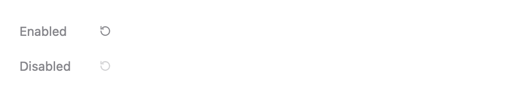

### Keyboard shortcut

SwiftUI: `.keyboardShortcut("z", modifiers: .command)`

nimbo: `ui.keymap(&[Binding::new(Shortcut::char('z').cmd(), Command::Undo)]).col(…)`

### Environment

SwiftUI: `.environment(\.tint, .green) { … }; @Environment(\.tint) var tint`

nimbo: `ui.environment(Tint(t.success())).row(style, |ui| { … }); ui.set_environment(Some(Tint(t.success()))) for the window; let tint = ui.environment_value::<Tint>()`

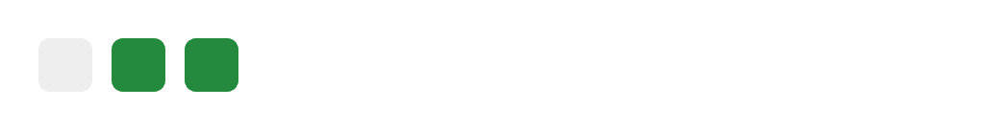

### Group

SwiftUI: `Group { Button("Save"); Toggle(…) }.disabled(true)`

nimbo: `ui.disabled(true).group(|ui| { ui.button("Save"); ui.toggle(&mut on, ()); }); ui.button("Open")`

### Identity

SwiftUI: `Box().id(item.id); .allowsHitTesting(false)`

nimbo: `ui.key(item.id).row(style, |ui| { … }); ui.with_id(id.key("box")).allows_hit_testing(false).col(style, |ui| { … })`

### Focus and pointer

SwiftUI: `.focusable(); .pointerStyle(.link)`

nimbo: `ui.focusable(true).pointer_style(Cursor::Pointer).row(style, |ui| { … })`

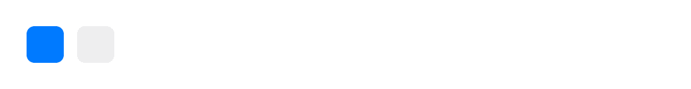

### Widget parts

SwiftUI: `.environment(\.isEnabled, true); .help(tip) on a part`

nimbo: `let tip = ui.take_help(); if let Some(tip) = &tip { ui.help(tip); } ui.environment(Enabled(true)).button("Undo")`

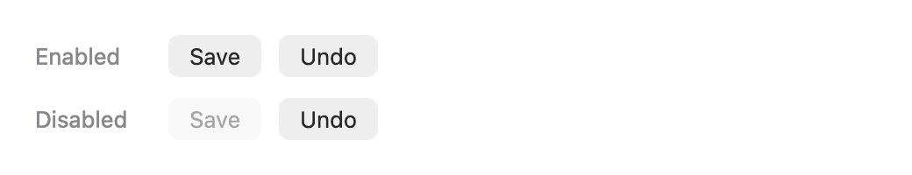

### Frame request

SwiftUI: `TimelineView(.animation) { context in … }`

nimbo: `ui.request_frame(); let k = ui.now().as_secs_f32() % 1.0`

### Accessibility pair

SwiftUI: `.accessibilityLabeledPair(role: .label, id: "volume", in: ns)`

nimbo: `ui.a11y_labeled_pair(LabeledPairRole::Label, id, |ui| ui.text("Volume", s)); ui.a11y_labeled_pair(LabeledPairRole::Content, id, |ui| ui.slider(&mut v, 0.0..=1.0))`

### Controls theme

SwiftUI: `@Environment(\.controlActiveState) var state`

nimbo: `let t = ui.controls_theme(); ui.el(Style::new().bg(t.accent())); let grey = ui.theme().inactive().accent()`

### Color scheme

SwiftUI: `@Environment(\.colorScheme) var colorScheme`

nimbo: `let dark = ui.color_scheme().is_dark()`

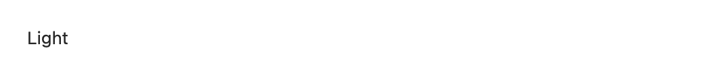
