# nimbo and SwiftUI

Each building block of nimbo beside its SwiftUI counterpart, as the gallery shows it live (`cargo run --release --example gallery`, a page per block in its variants). A block aims at its SwiftUI counterpart's behaviour and API shape without copying it 1:1. Its code is the gallery's for the block, cut from the block's own, so it builds what the picture shows. The pictures are the gallery's, in the light appearance, kept on the repo's `assets` branch: `make api-shots` makes them and this file again from the gallery's table (`examples/gallery.rs`), so a block changes there.

On macOS SwiftUI's `List` has neither of the grouped styles (`InsetGroupedListStyle` and `GroupedListStyle` are iOS's): nimbo's `InsetGroupedListStyle` takes the iOS name for the plates of the grouped `Form` (`.formStyle(.grouped)`), which its sections share.

## Layout

### Row

SwiftUI: `HStack(alignment: .top, spacing: 8) { … }`

```rust
let t = ui.theme();
for y in [Align::Start, Align::Center, Align::End] {
  ui.col(Style::new().gap(6.0).align(Align::Center, Align::Start), |ui| {
    let row = Style::new().gap(8.0).align(Align::Start, y).pad(8.0).radius(8.0);
    ui.row(row.border(1.0, t.line()).bg(t.panel()), |ui| {
      for h in [16.0, 40.0, 28.0] {
        ui.el(Style::new().w(px(24.0)).h(px(h)).radius(5.0).bg(t.accent()));
      }
    });
    ui.text(format_args!("{y:?}"), t.muted());
  });
}
```


### Column

SwiftUI: `VStack(alignment: .leading, spacing: 6) { … }`

```rust
let t = ui.theme();
for x in [Align::Start, Align::Center, Align::End] {
  ui.col(Style::new().gap(6.0).align(Align::Center, Align::Start), |ui| {
    let col = Style::new().gap(6.0).align(x, Align::Start).pad(8.0).radius(8.0);
    ui.col(col.border(1.0, t.line()).bg(t.panel()), |ui| {
      for w in [40.0, 88.0, 64.0] {
        ui.el(Style::new().w(px(w)).h(px(14.0)).radius(4.0).bg(t.accent()));
      }
    });
    ui.text(format_args!("{x:?}"), t.muted());
  });
}
```


### Grid

SwiftUI: `Grid(horizontalSpacing: 6, verticalSpacing: 6) { GridRow { … } }; .gridCellColumns(2)`

```rust
let t = ui.theme();
let key = Style::new().w(grow()).h(px(32.0)).center().radius(6.0).bg(t.raised());
ui.grid(3, Style::new().w(px(132.0)).gap(6.0), |ui| {
  for k in ["7", "8", "9", "4", "5", "6", "1", "2", "3"] {
    ui.row(key, |ui| ui.text(k, t.label()));
  }

  ui.span(2).row(key, |ui| ui.text("0", t.label()));
  ui.row(key, |ui| ui.text(".", t.label()));
});
```


### Spacer

SwiftUI: `HStack { Text("Notes"); Spacer(); Button("Share") { … } }`

```rust
let t = ui.theme();
let bar = Style::new().w(px(300.0)).h(px(40.0)).pad_xy(12.0, 0.0).gap(8.0);
let bar = bar.align(Align::Start, Align::Center).radius(8.0).border(1.0, t.line());
let bar = bar.bg(t.panel());
ui.col(Style::new().gap(8.0), |ui| {
  ui.row(bar, |ui| {
    ui.text("Notes", t.label());
    ui.spacer();
    ui.button("Share");
  });

  ui.row(bar, |ui| {
    ui.spacer();
    ui.text("In the middle", t.label());
    ui.spacer();
  });
});
```


### Divider

SwiftUI: `HStack { Text("Cut"); Divider(); Text("Copy") }; VStack { …; Divider(); … }`

```rust
let t = ui.theme();
let panel = Style::new().pad(10.0).radius(8.0).border(1.0, t.line()).bg(t.panel());
ui.row(panel.h(px(44.0)).gap(10.0).align(Align::Start, Align::Center), |ui| {
  ui.text("Cut", t.label());
  ui.divider();
  ui.text("Copy", t.label());
  ui.divider();
  ui.text("Paste", t.label());
});

ui.col(panel.w(px(160.0)).gap(8.0), |ui| {
  ui.text("Wi-Fi", t.label());
  ui.divider();
  ui.text("Bluetooth", t.label());
  ui.divider();
  ui.text("Network", t.label());
});
```


### Scroll view

SwiftUI: `ScrollView(.vertical) { … }`

```rust
let t = ui.theme();
let area = Style::new().w(px(200.0)).h(px(98.0)).radius(8.0).border(1.0, t.line());
ui.scroll_area(area.bg(t.panel()).scroll(Axes::VERTICAL), |ui| {
  for i in 1..=20 {
    let line = Style::new().w(grow()).h(px(24.0)).pad_xy(10.0, 0.0);
    ui.row(line.align(Align::Start, Align::Center), |ui| {
      ui.text(format_args!("Line {i}"), t.label())
    });
  }
});
```


### Scroll anchor

SwiftUI: `ScrollView { LazyVStack { … } }.defaultScrollAnchor(.bottom)`

```rust
let t = ui.theme();
let area = Style::new().w(px(260.0)).h(px(134.0)).pad(8.0).gap(6.0).radius(8.0);
let area = area.border(1.0, t.line()).bg(t.panel());
ui.default_scroll_anchor(UnitPoint::BOTTOM).scroll_area(area, |ui| {
  for i in 1..=12 {
    let mine = i % 2 == 0;
    let (side, bg, ink) = match mine {
      true => (Align::End, t.accent(), t.on_accent()),
      false => (Align::Start, t.raised(), t.text()),
    };

    let bubble = Style::new().pad_xy(10.0, 5.0).radius(12.0).bg(bg);
    ui.row(Style::new().w(grow()).align(side, Align::Start), |ui| {
      let text = TextStyle::new(t.font(), ink);
      ui.row(bubble, |ui| ui.text(format_args!("Message {i}"), text));
    });
  }
});
```


### Content margins

SwiftUI: `ScrollView { … }.contentMargins(.top, 28).contentMargins(.bottom, 8)`

```rust
let t = ui.theme();
let area = Style::new().w(px(260.0)).h(px(110.0)).pad_xy(8.0, 0.0);
let area = area.border(1.0, t.line()).bg(t.panel());
let ui = ui.content_margins([28.0, 0.0, 8.0, 0.0], ContentMarginPlacement::Automatic);
ui.scroll_area(area, |ui| {
  for i in 1..=8 {
    ui.text(format_args!("Line {i}"), t.label());
  }

  let head = Style::new().w(pct(100.0)).h(px(28.0)).pad_xy(8.0, 0.0);
  let head =
    head.align(Align::Start, Align::Center).border(1.0, t.line()).bg(t.raised());
  ui.float(Float::parent()).row(head, |ui| ui.text("Header", t.section()));
});
```


### Overlay

SwiftUI: `.overlay(alignment: .topTrailing) { … }`

```rust
let t = ui.theme();
let card = Style::new().w(px(80.0)).h(px(48.0)).radius(6.0).bg(t.raised());
ui.row(card, |ui| {
  let at = UnitPoint::TOP_TRAILING;
  let dot = Style::new().w(px(12.0)).h(px(12.0)).radius(6.0).bg(t.accent());
  ui.float(Float::parent().attach(at).anchor(at).offset(-4.0, 4.0)).el(dot);
});
```


## Text

### Text

SwiftUI: `Text("Title").font(.headline).foregroundStyle(.secondary)`

```rust
let t = ui.theme();
ui.text("Title", TextStyle::new(t.bold(), t.text()));
ui.text("Body", t.label());
ui.text("Secondary", t.muted());
```


### Localized text

SwiftUI: `Text("Keep the history"); String(localized: "\(name) is not on disk")`

```rust
let t = ui.theme();
let name = "parakeet";
ui.col(Style::new().gap(4.0), |ui| {
  ui.text(t!("Keep the history"), t.label());
  ui.text(t!("{name} is not on disk", name), t.label());
  ui.text(tn!("{n} file", "{n} files", 3), t.muted());
});
```


### Line limit

SwiftUI: `Text(path).lineLimit(1).truncationMode(.middle)`

```rust
let t = ui.theme();
let path = "/Users/alex/Library/Application Support/Example/cache.db";
ui.col(Style::new().w(px(300.0)).gap(4.0), |ui| {
  for mode in [TruncationMode::Head, TruncationMode::Middle, TruncationMode::Tail] {
    ui.text(path, t.body().truncation(mode));
  }
});
```


### Underline

SwiftUI: `Text("WER").underline(pattern: .dot)`

```rust
let t = ui.theme();
let patterns = [
  (LinePattern::Solid, "solid"),
  (LinePattern::Dot, "dot"),
  (LinePattern::Dash, "dash"),
  (LinePattern::DashDot, "dashDot"),
  (LinePattern::DashDotDot, "dashDotDot"),
];
for (p, n) in patterns {
  ui.text(n, t.label().underline(p));
}

ui.text("struck", t.label().strikethrough(LinePattern::Solid));
```

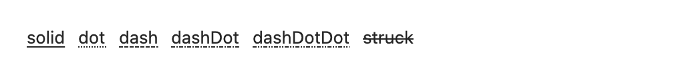

### Styled text

SwiftUI: `Text("fn ").foregroundStyle(.pink).bold() + Text("main").italic(); Text(attributedString).textSelection(.enabled)`

```rust
let t = ui.theme();
let a = Attributes::new();
let mut prose = AttributedString::new();
prose.push("Runs ", a).push("in bold", a.weight(Weight::Bold)).push(", ", a);
prose.push("italic", a.italic()).push(", ", a).push("colour", a.color(t.accent()));
prose.push(", ", a).push("code", a.design(Design::Monospaced)).push(", ", a);
prose.push("lines", a.underline(LinePattern::Solid)).push(" and ", a);
prose.push("grounds", a.background(alpha(t.warning(), 0.3)));
prose.push(" wrap as one paragraph.", a);

let (kw, name, lit) = (a.color(t.danger()), a.color(t.accent()), a.color(t.success()));
let mut code = AttributedString::new();
code.push("fn ", kw.weight(Weight::Bold)).push("main", name).push("() {\n  ", a);
code.push("let ", kw.weight(Weight::Bold)).push("n = ", a).push("42", lit);
code.push(";  ", a).push("// the answer", a.color(t.secondary()).italic());
code.push("\n}", a);

let (gone, added) =
  (a.background(alpha(t.danger(), 0.18)), a.background(alpha(t.success(), 0.18)));
let mut diff = AttributedString::new();
diff.push("- let n = ", gone).push("41", a.background(alpha(t.danger(), 0.4)));
diff.push(";\n", gone).push("+ let n = ", added);
diff.push("42", a.background(alpha(t.success(), 0.4))).push(";", added);

let mono = TextStyle::new(Font::mono(12.0), t.text());
ui.col(Style::new().w(px(300.0)).gap(10.0), |ui| {
  ui.text(&prose, t.body());
  _ = ui.selectable_text(&code, mono);
  ui.text(&diff, mono);
});
```


### Selectable text

SwiftUI: `Text(log).textSelection(.enabled)`

```rust
let t = ui.theme();
ui.col(Style::new().w(px(300.0)), |ui| {
  _ = ui.selectable_text("Select this text and copy it.", t.body())
});
```


### Link

SwiftUI: `Link("Learn more", destination: url)`

```rust
ui.link("Learn more…");
```

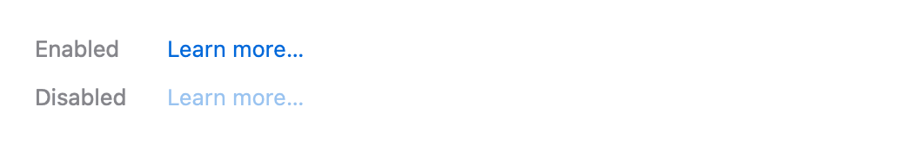

### Image

SwiftUI: `Image(systemName: "gear")`

```rust
let t = ui.theme();
for icon in [Icon::GEAR, Icon::FOLDER, Icon::TRASH, Icon::INFO] {
  ui.icon(icon.stroke(1.6), 20.0, t.text());
}
```


### Label content

SwiftUI: `Label { Text(title) } icon: { Image(systemName: "folder") }; configuration.label in a style`

```rust
let t = ui.theme();
let id = Id::of("label content");
let labels: [Content; 3] =
  [Icon::FOLDER.into(), "Data folder".into(), Icon::INFO.into()];
for (k, label) in labels.into_iter().enumerate() {
  label.build(ui.with_id(id.key(k)), t.label());
}
```


### Photo

SwiftUI: `Image(nsImage: NSImage(data: file)!).resizable().aspectRatio(contentMode: .fill).frame(width: 80, height: 80).clipped()`

```rust
let t = ui.theme();
// Stretched to its box, then in its aspect: filling a square, fitting it.
if let Some(photo) = &self.photo {
  ui.image(photo, Style::new().w(px(120.0)).h(px(80.0)));
  let square = Style::new().w(px(80.0)).h(px(80.0)).bg(t.panel());
  ui.aspect_ratio(ContentMode::Fill).image(photo, square);
  ui.aspect_ratio(ContentMode::Fit).image(photo, square);
}
```


## Controls

### Button

SwiftUI: `Button("Save") { … }.buttonStyle(.borderedProminent)`

```rust
ui.button("Bordered");
ui.button_style(&BorderedProminentButtonStyle).button("Prominent");
ui.button_style(&BorderlessButtonStyle).button("Borderless");
```


### Button role

SwiftUI: `Button("Delete", role: .destructive) { … }`

```rust
Button::new("Delete").role(ButtonRole::Destructive).show(ui);
let red = Button::new("Delete").role(ButtonRole::Destructive);
red.show(ui.button_style(&BorderedProminentButtonStyle));
```


### Icon button

SwiftUI: `Button { Image(systemName: "trash") }.buttonStyle(.borderless)`

```rust
ui.a11y_label("Reset").icon_button(Icon::RESET);
ui.icon_button(Icon::TRASH);
```


### Button style

SwiftUI: `HStack { Button("Cut") { … }; Button("Copy") { … } }.buttonStyle(.borderless)`

```rust
let row = Style::new().gap(10.0).align(Align::Start, Align::Center);
ui.button_style(&BorderlessButtonStyle).row(row, |ui| {
  ui.button("Cut");
  ui.button("Copy");
});
ui.button("Paste");
```

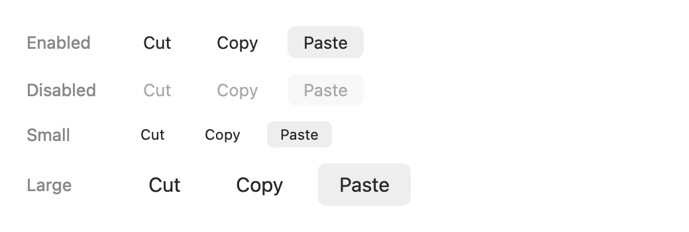

### Custom button style

SwiftUI: `struct Pill: ButtonStyle { func makeBody(configuration: Configuration) -> some View { configuration.label.padding(…).background(…) } }`

```rust
/// A capsule tinted with the accent, deeper while held, faint when disabled.
struct Pill;

impl ButtonStyle for Pill {
  fn make_body(&self, ui: &mut Ui, mut c: ButtonConfiguration) {
    let t = ui.theme();
    let (k, ink) = match (c.is_enabled(), c.is_pressed()) {
      (false, _) => (0.06, alpha(t.accent(), 0.4)),
      (true, pressed) => (if pressed { 0.3 } else { 0.15 }, t.accent()),
    };

    let s = Style::new().h(px(24.0)).pad_xy(12.0, 0.0).gap(5.0).center().radius(12.0);
    ui.row(s.bg(alpha(t.accent(), k)), |ui| c.label(ui, TextStyle::new(t.font(), ink)));
  }
}

ui.button_style(&Pill).button("Pill");
Button::new("Open").icon(Icon::FOLDER).show(ui.button_style(&Pill));
```


### Switch

SwiftUI: `Toggle("Live", isOn: $live)`

```rust
ui.toggle(&mut self.live, "Live");
```

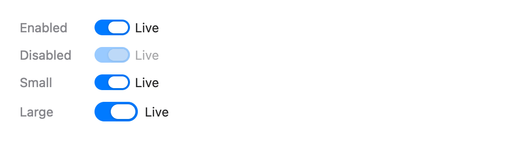

### Check box

SwiftUI: `Toggle("Wrap", isOn: $wrap).toggleStyle(.checkbox)`

```rust
ui.toggle_style(&CheckboxToggleStyle).toggle(&mut self.wrap, "Wrap");
```

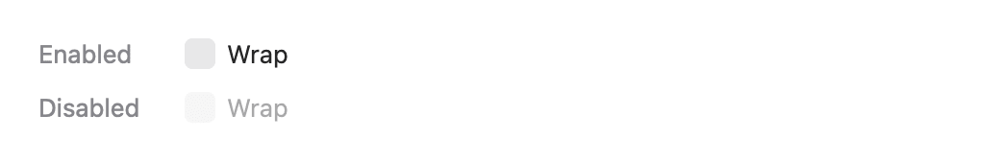

### Button toggle

SwiftUI: `Toggle("Bold", isOn: $bold).toggleStyle(.button)`

```rust
ui.toggle_style(&ButtonToggleStyle).toggle(&mut self.bold, "Bold");
ui.toggle_style(&ButtonToggleStyle).toggle(&mut self.italic, "Italic");
```

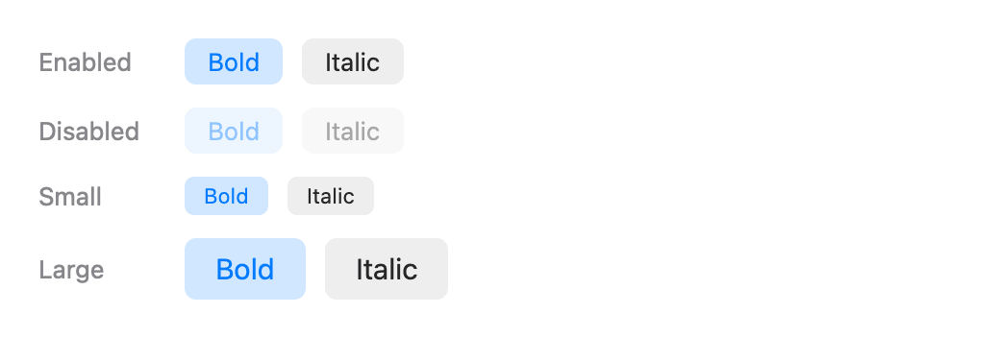

### Toggle style

SwiftUI: `VStack { Toggle("Wrap", …); Toggle("Numbers", …) }.toggleStyle(.checkbox)`

```rust
ui.toggle_style(&CheckboxToggleStyle).col(Style::new().gap(6.0), |ui| {
  ui.toggle(&mut self.wrap, "Wrap");
  ui.toggle(&mut self.numbers, "Numbers");
});
ui.toggle(&mut self.live, "Live");
```

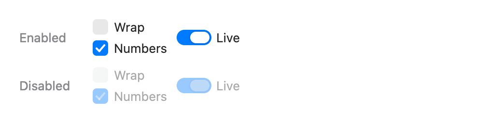

### Custom toggle style

SwiftUI: `struct Dot: ToggleStyle { func makeBody(configuration: Configuration) -> some View { HStack { Circle()…; configuration.label } } }`

```rust
/// A dot in the accent before the label, filled while on, ringed while off; faint when
/// disabled.
struct Dot;

impl ToggleStyle for Dot {
  fn make_body(&self, ui: &mut Ui, mut c: ToggleConfiguration) {
    let t = ui.theme();
    let k = if c.is_enabled() { 1.0 } else { 0.4 };
    let dot = Style::new()
      .w(px(12.0))
      .h(px(12.0))
      .radius(6.0)
      .border(1.5, alpha(t.accent(), k));
    let dot = if c.is_on() { dot.bg(alpha(t.accent(), k)) } else { dot };
    ui.row(Style::new().gap(6.0).center(), |ui| {
      ui.el(dot);
      c.label(ui, TextStyle::new(t.font(), alpha(t.text(), k)));
    });
  }
}

ui.toggle_style(&Dot).toggle(&mut self.live, "Live");
ui.toggle_style(&PlainToggleStyle).toggle(&mut self.wrap, "Plain");
```

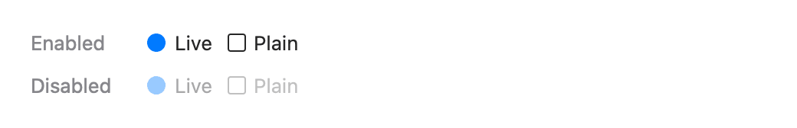

### Slider

SwiftUI: `Slider(value: $zoom, in: 0...200)`

```rust
ui.col(Style::new().w(px(160.0)), |ui| {
  ui.a11y_label("Zoom").slider(&mut self.zoom, 0.0..=200.0);
});
ui.label(format_args!("{:.0}%", self.zoom));
```

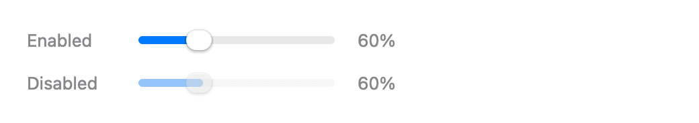

### Slider steps

SwiftUI: `Slider(value: $level, in: 10...90, step: 10) { … } tick: { v in SliderTick(v) { … } }`

```rust
let label = |v: f32| [10.0, 50.0, 90.0].contains(&v).then(|| format!("{v}%"));
let s = Slider::new(&mut self.level, 10.0..=90.0).step(10.0).tick_label(label);
ui.col(Style::new().w(px(160.0)), |ui| s.show(ui.a11y_label("Level")));
ui.label(format_args!("{:.0}%", self.level));
```

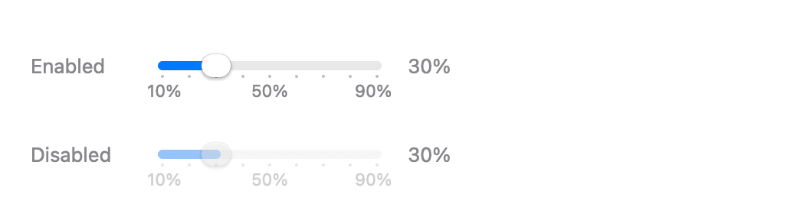

### Slider style

SwiftUI: `Slider(value: $zoom, in: 0...200) (SwiftUI has no slider style)`

```rust
ui.col(Style::new().w(px(160.0)).gap(8.0), |ui| {
  ui.slider_style(&PlainSliderStyle).col(Style::new().w(grow()), |ui| {
    ui.a11y_label("Zoom").slider(&mut self.zoom, 0.0..=200.0);
  });
  ui.a11y_label("Zoom").slider(&mut self.zoom, 0.0..=200.0);
});
```


### Custom slider style

SwiftUI: `struct Meter: ProgressViewStyle { … } (SwiftUI has no slider style)`

```rust
/// A capsule filled in the accent up to the value, a notch at each step between its
/// ends, no knob; faint when disabled.
struct Meter;

impl SliderStyle for Meter {
  fn make_body(&self, ui: &mut Ui, c: SliderConfiguration) {
    let t = ui.theme();
    let a = if c.is_enabled() { 1.0 } else { 0.4 };
    let (k, track, fill) =
      (c.fraction(), alpha(t.accent(), 0.15 * a), alpha(t.accent(), a));
    let notch = alpha(t.bg(), 0.8);
    let notches: Vec<f32> =
      c.steps().map(|(_, p)| p).filter(|p| *p > 0.0 && *p < 1.0).collect();
    c.root(ui).canvas(Style::new().w(grow()).h(px(8.0)), move |f, r| {
      f.rect(r, track, 4.0);
      f.rect(Rect::new(r.x, r.y, r.w * k, r.h), fill, 4.0);
      for p in &notches {
        f.rect(Rect::new(r.x + r.w * p - 0.5, r.y, 1.0, r.h), notch, 0.0);
      }
    });
  }
}

let t = ui.theme();
let s = Slider::new(&mut self.level, 10.0..=90.0).step(10.0);
ui.col(Style::new().w(px(160.0)), |ui| {
  s.show(ui.slider_style(&Meter).a11y_label("Level"));
});
ui.text(format_args!("{:.0}%", self.level), t.muted().nowrap());
```

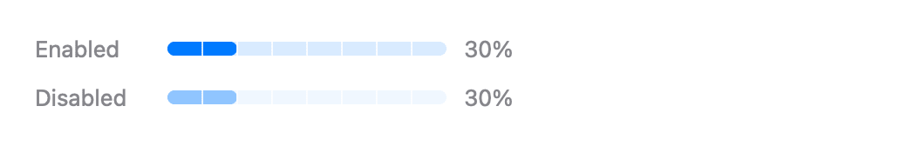

### Picker

SwiftUI: `Picker("Size", selection: $size) { …; Divider(); … }`

```rust
let p = Picker::new(&mut self.size).options(&SIZES[..1]).divider();
p.options(&SIZES[1..]).show(ui.a11y_label("Size"));
```


### Segmented picker

SwiftUI: `Picker(…) { … }.pickerStyle(.segmented)`

```rust
let views = [
  Tag::new(0, "List").count(128),
  Tag::new(1, "Grid").count(12),
  Tag::new(2, "Columns").count(3),
];
ui.picker_style(&SegmentedPickerStyle).picker(&mut self.view, &views);
```

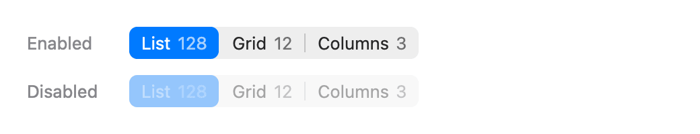

### Picker style

SwiftUI: `VStack { Picker(…) { … } }.pickerStyle(.inline); Picker(…) { … }`

```rust
let row = Style::new().gap(10.0).align(Align::Start, Align::Center);
ui.picker_style(&InlinePickerStyle).row(row, |ui| {
  ui.a11y_label("Size").picker(&mut self.size, &SIZES);
});
ui.a11y_label("Size").picker(&mut self.size, &SIZES);
```


### Custom picker style

SwiftUI: `struct Chips: PickerStyle (SwiftUI's is closed: its styles are the system's)`

```rust
/// The options as capsules, the selected one filled with the accent; disabled, grey,
/// as AppKit's disabled controls lose the accent.
struct Chips;

impl PickerStyle for Chips {
  fn make_body(&self, ui: &mut Ui, mut c: PickerConfiguration) {
    let t = ui.theme();
    let b = c.segments(ui);
    ui.row(Style::new().gap(4.0), |ui| {
      for i in 0..c.len() {
        let on = c.selection() == Some(i);
        let (bg, ink) = match (c.is_enabled(), on) {
          (true, true) => (t.accent(), t.on_accent()),
          (true, false) => (alpha(t.accent(), 0.12), t.accent()),
          (false, true) => (t.raised(), t.tertiary()),
          (false, false) => ([0.0; 4], t.tertiary()),
        };

        let chip =
          Style::new().h(px(22.0)).pad_xy(10.0, 0.0).center().radius(11.0).bg(bg);
        ui.with_id(c.item_id(i)).row(b.pointer(chip), |ui| {
          ui.text(c.label(i), TextStyle::new(t.font(), ink))
        });
      }
    });
  }
}

let views = [Tag::new(0, "List"), Tag::new(1, "Grid"), Tag::new(2, "Columns")];
ui.picker_style(&Chips).picker(&mut self.view, &views);
```


### Text field

SwiftUI: `TextField("Name", text: $name)`

```rust
ui.col(Style::new().w(px(200.0)), |ui| ui.text_field(&mut self.name, "Name"));
```


### Multi-line field

SwiftUI: `TextField("Notes", text: $notes, axis: .vertical)`

```rust
ui.col(Style::new().w(px(200.0)).h(px(60.0)), |ui| {
  TextField::new(&mut self.notes, "Notes").axis(Axis::Vertical).show(ui);
});
```


### Secure field

SwiftUI: `SecureField("Password", text: $key)`

```rust
ui.col(Style::new().w(px(200.0)), |ui| ui.secure_field(&mut self.key, "Password"));
```


### Search field

SwiftUI: `.searchable(text: $query)`

```rust
ui.col(Style::new().w(px(200.0)), |ui| ui.search_field(&mut self.query, "Search"));
```


### Date picker

SwiftUI: `DatePicker("Start", selection: $start, in: ...end, displayedComponents: .date)`

```rust
let end = Date::new(2027, 12, 31).unwrap();
DatePicker::new(&mut self.start).range(..=end).show(ui.a11y_label("Start"));
```


### Date picker style

SwiftUI: `DatePicker(…).datePickerStyle(.field)`

```rust
ui.date_picker_style(&FieldDatePickerStyle)
  .a11y_label("Start")
  .date_picker(&mut self.start);
```


### Character palette

SwiftUI: `NSApp.orderFrontCharacterPalette(nil), Edit ▸ Emoji & Symbols (AppKit; SwiftUI has none)`

```rust
ui.col(Style::new().w(px(200.0)), |ui| ui.text_field(&mut self.message, "Message"));
if character_palette::available().is_ok() && ui.icon_button(Icon::SMILE).clicked {
  ui.character_palette();
}
```


### Text field style

SwiftUI: `VStack { TextField("Name", text: $name); TextField("City", text: $city) }.textFieldStyle(.plain)`

```rust
let col = Style::new().w(px(120.0)).gap(6.0);
ui.text_field_style(&PlainTextFieldStyle).col(col, |ui| {
  ui.text_field(&mut self.name, "Name");
  ui.text_field(&mut self.city, "City");
});
ui.col(Style::new().w(px(160.0)), |ui| ui.text_field(&mut self.email, "E-mail"));
```


### Custom text field style

SwiftUI: `struct Underline: TextFieldStyle { func _body(configuration: TextField<_Label>) -> some View { configuration.padding(…).overlay(alignment: .bottom) { … } } }`

```rust
/// The text over a line, the accent's while focused, which rings nothing else.
struct Underline;

impl TextFieldStyle for Underline {
  fn make_body(&self, ui: &mut Ui, mut c: TextFieldConfiguration) {
    let t = ui.theme();
    let line = if c.is_focused() { t.accent() } else { t.line() };
    let s = Style::new().w(grow()).h(px(24.0)).pad_xy(2.0, 0.0);
    let s = s.borders([0.0, 0.0, 1.0, 0.0], line).align(Align::Start, Align::Center);
    let s = s.focusable_quiet().scroll(c.axis().into());
    let s = if c.is_enabled() { s } else { s.opacity(t.disabled()) };
    let text =
      FieldStyle::new(TextStyle::new(t.font(), t.text())).placeholder(t.faint());
    ui.row(s, |ui| c.text(ui, &text.caret(t.accent())));
  }
}

ui.col(Style::new().w(px(200.0)), |ui| {
  ui.text_field_style(&Underline).text_field(&mut self.city, "City");
});
```


### Progress

SwiftUI: `ProgressView(value: 0.42)`

```rust
ui.col(Style::new().w(px(150.0)), |ui| ui.progress(Some(0.42)));
ui.col(Style::new().w(px(150.0)), |ui| ui.progress(None));
```


### Spinner

SwiftUI: `ProgressView()`

```rust
ui.spinner();
```


### Badge

SwiftUI: `.badge("New")`

```rust
ui.badge(128, Tone::Neutral);
ui.badge("New", Tone::Accent);
ui.badge("+5", Tone::Success);
ui.badge("-4", Tone::Danger);
ui.badge("Conflict", Tone::Warning);
```

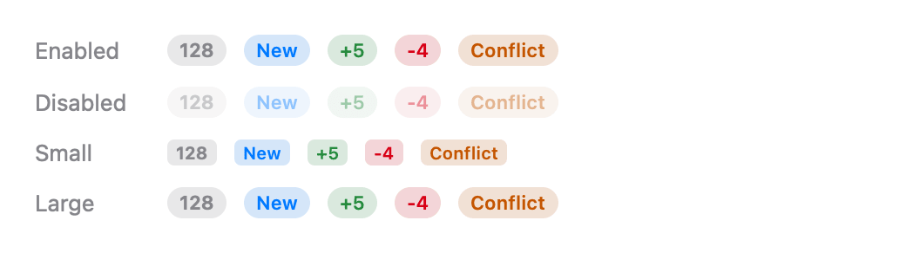

### Hotkey recorder

SwiftUI: `KeyboardShortcut (SwiftUI has no recorder)`

```rust
ui.hotkey_recorder(&mut self.hotkey);
// The ⊗ that clears one, which the plates themes leave to a reset button.
let t = ui.theme();
ui.set_theme(t.with_hotkey_recorder_clear(true));
ui.hotkey_recorder(&mut self.hotkey);
ui.set_theme(t);
```


### Control behavior

SwiftUI: `Button(action:) { … }.buttonStyle(MyStyle()), a look of the app's own`

```rust
let t = ui.theme();
let id = ui.take_id();
let b = ui.button_behavior(id);
let fill = match (b.pressed, b.hovered) {
  (true, _) => t.accent_hover(),
  (_, true) => mix(t.accent(), t.accent_hover(), 0.5),
  _ => t.accent(),
};

let (fill, mark) = match b.disabled {
  true => (alpha(fill, t.disabled()), alpha([1.0; 4], t.disabled())),
  false => (fill, [1.0; 4]),
};

let ring = if b.focused { t.focus() } else { [0.0; 4] };
let s = Style::new().w(px(28.0)).h(px(28.0));

ui.control(&b).canvas(s, move |f, r| {
  f.quad(Quad::new(r, fill).radius(14.0).border(2.0, ring));
  Icon::PLAY.draw(f, Rect::new(r.x + 7.0, r.y + 7.0, 14.0, 14.0), mark);
});
```


### Help marks

SwiftUI: `Image(systemName: "info.circle").help(tip); HelpLink { … }`

```rust
ui.help("An ⓘ explains what one line can't").info_button();
ui.help("A warning tells what is wrong").warning_button();
ui.help("Opens the page's help").help_button();
```

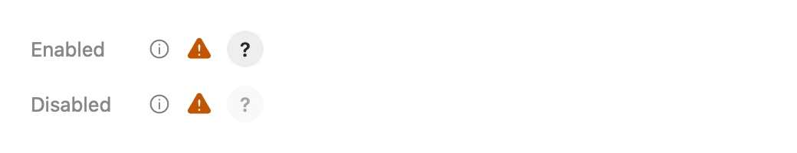

## Form

### Section

SwiftUI: `Section { … } header: { … } footer: { … }`

```rust
let fs = FormStyle::plates(&ui.theme());
let form = Style::new().w(grow()).gap(10.0).pad(10.0).radius(12.0).bg(fs.bg());
ui.col(form, |ui| {
  let head = |ui: &mut Ui, s: TextStyle| {
    ui.text("Storage", s);
    ui.spacer();
    ui.text("640 MB used", fs.note());
  };
  let section = Section::new(head).footer("Kept until you clear it.");
  ui.form_section(&fs, section, |ui| {
    ui.form_row(&fs, FormRow::new("Keep the history"), |ui| ui.toggle(&mut self.on, ()))
  });
});
```


### Form row

SwiftUI: `LabeledContent { Toggle(isOn: $on) {} } label: { Text(title); Text(subtitle) }`

```rust
let fs = FormStyle::plates(&ui.theme());
let form = Style::new().w(grow()).gap(10.0).pad(10.0).radius(12.0).bg(fs.bg());
ui.col(form, |ui| {
  ui.form_section(&fs, "", |ui| {
    let row =
      FormRow::new("Open at login").caption("Starts with your Mac, in the menu bar.");
    ui.form_row(&fs, row, |ui| ui.toggle(&mut self.on, ()))
  });
});
```


### Composed label

SwiftUI: `label: { Text(name); Text("New").badge(…) }`

```rust
let fs = FormStyle::plates(&ui.theme());
let form = Style::new().w(grow()).gap(10.0).pad(10.0).radius(12.0).bg(fs.bg());
let label = |ui: &mut Ui, s: TextStyle| {
  ui.text("gigaam-v3", s.line_limit(1));
  let ui = ui.help("Best in Russian").control_size(ControlSize::Small);
  ui.badge("Recommended", Tone::Accent);
};

let caption = |ui: &mut Ui, s: TextStyle| {
  ui.row(Style::new().w(grow()), |ui| {
    ui.help("Errors per 100 words").text("WER 4.7%", s.underline(LinePattern::Dot));
    ui.text(" · 274 MB", s);
  });
};
ui.col(form, |ui| {
  ui.form_section(&fs, "", |ui| {
    ui.form_row(&fs, FormRow::new(label).caption(caption), |ui| ui.button("Use"))
  });
});
```


### Row tile

SwiftUI: `Label { Text(title) } icon: { Image(systemName: "folder") }`

```rust
let fs = FormStyle::plates(&ui.theme());
let form = Style::new().w(grow()).gap(10.0).pad(10.0).radius(12.0).bg(fs.bg());
ui.col(form, |ui| {
  ui.form_section(&fs, "", |ui| {
    let row = FormRow::new("Data folder").caption("~/Library/Application Support");
    ui.form_row(&fs, row.tile(Icon::FOLDER), |ui| ui.button("Show"))
  });
});
```

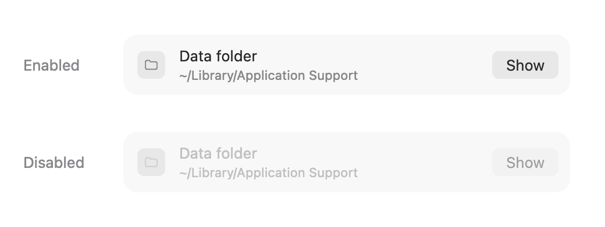

### Row footer

SwiftUI: `Section { VStack { Toggle(…); Slider(…) } }`

```rust
let fs = FormStyle::plates(&ui.theme());
let form = Style::new().w(grow()).gap(10.0).pad(10.0).radius(12.0).bg(fs.bg());
let (name, off) = (format!("Turn off below {:.0}%", self.level), !self.on);
let footer = |ui: &mut Ui, _: TextStyle| {
  let label = |v: f32| [10.0, 50.0, 90.0].contains(&v).then(|| format!("{v}%"));
  let s = Slider::new(&mut self.level, 10.0..=90.0).step(10.0).tick_label(label);
  s.show(ui.disabled(off).a11y_label("Level"));
};

ui.col(form, |ui| {
  ui.form_section(&fs, "", |ui| {
    let row = FormRow::new(&name).caption("Only on battery.").footer(footer);
    ui.form_row(&fs, row, |ui| ui.toggle(&mut self.on, ()))
  });
});
```

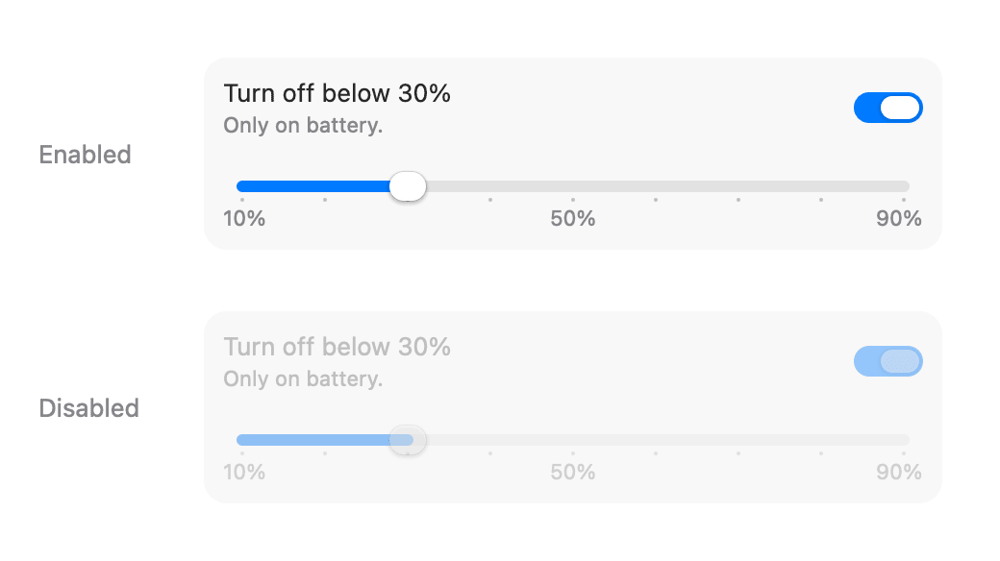

### Disclosure

SwiftUI: `DisclosureGroup("Other models") { … }`

```rust
let fs = FormStyle::plates(&ui.theme());
let form = Style::new().w(grow()).gap(10.0).pad(10.0).radius(12.0).bg(fs.bg());
ui.col(form, |ui| {
  ui.form_section(&fs, "", |ui| {
    let row = FormRow::new("Other models").caption("2 more");
    ui.form_disclosure(&fs, row, |ui| {
      ui.form_row(&fs, FormRow::new("whisper-tiny"), |_| {})
    })
  });
});
```


### Toolbar tabs

SwiftUI: `TabView(selection: $page) { General().tabItem { Label("General", systemImage: "gear") }.tag(Page.general) } in a Settings scene`

```rust
let fs = FormStyle::plates(&ui.theme());
let form = Style::new().w(grow()).gap(10.0).pad(10.0).radius(12.0).bg(fs.bg());
let tabs =
  [Tag::new(0, "General").icon(Icon::GEAR), Tag::new(1, "About").icon(Icon::INFO)];
ui.col(form, |ui| ui.toolbar_tabs(&fs, &mut self.tab, &tabs));
```


### Footer

SwiftUI: `HelpLink { … } at a pane's end`

```rust
let fs = FormStyle::plates(&ui.theme());
let form = Style::new().w(grow()).gap(10.0).pad(10.0).radius(12.0).bg(fs.bg());
ui.col(form, |ui| {
  ui.form_section(&fs, "History", |ui| {
    ui.form_row(&fs, FormRow::new("Keep the history"), |ui| ui.toggle(&mut self.on, ()))
  });
  ui.help("Help on these settings").form_footer(&fs, |ui| _ = ui.button("Reset All…"));
});
```


## List

### List

SwiftUI: `List(items, selection: $sel) { … }`

```rust
let t = ui.theme();
let list = List::new(40, 22.0).selection(&mut self.rows);
let list = list.style(Style::new().w(px(220.0)).h(px(88.0)));
list.show(ui, |ui, row| ui.text(format_args!("Row {}", row.index + 1), t.label()));
```


### List sections

SwiftUI: `Section(header:) in a List; .listStyle(…)`

```rust
let t = ui.theme();
let head = |ui: &mut Ui, g: usize| ui.text(["Today", "Yesterday"][g], t.section());
let list = List::new(6, 30.0).sections(&[0, 3], 24.0, &head).selection(&mut self.rows);
let list = list.style(Style::new().w(px(320.0)).h(px(290.0)));
let ui = ui.list_style(&InsetGroupedListStyle);
list
  .show(ui, |ui, row| ui.text(format_args!("Dictation {}", row.index + 1), t.label()));
```

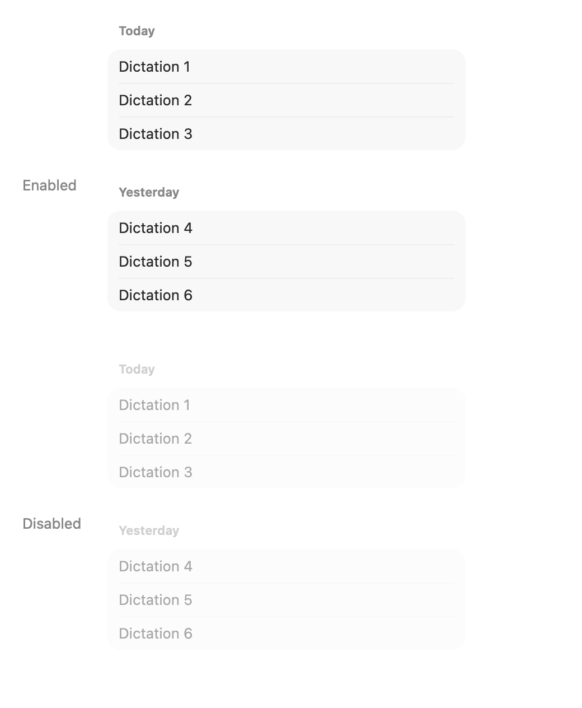

### List style

SwiftUI: `List(items, selection: $sel) { … }.listStyle(.plain)`

```rust
let t = ui.theme();
let frame = Style::new().w(px(160.0)).h(px(88.0));
let text = |row: Row| match row.selected {
  true => TextStyle::new(t.font(), t.accent()),
  false => t.label(),
};
let [plain_rows, rows] = &mut self.styled_rows;
let plain = List::new(40, 22.0).style(frame).selection(plain_rows);
plain.show(ui.list_style(&PlainListStyle), |ui, row| {
  ui.text(format_args!("Row {}", row.index + 1), text(row));
});

let inset = List::new(40, 22.0).style(frame).selection(rows);
inset.show(ui, |ui, row| ui.text(format_args!("Row {}", row.index + 1), t.label()));
```

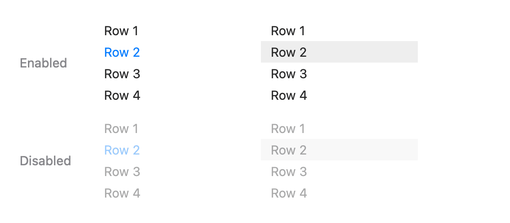

### Custom list style

SwiftUI: `struct Stripes: ListStyle (SwiftUI's has no public makeBody)`

```rust
/// On a rounded panel, every other row tinted, the selected one a rounded tile of the
/// accent, fainter while the list is not focused; faded when disabled.
struct Stripes;

impl ListStyle for Stripes {
  fn make_body<'a>(&self, ui: &mut Ui<'a>, mut c: ListConfiguration<'_, 'a>) {
    let t = ui.theme();
    let frame = c.frame().radius(8.0).bg(t.panel());
    let frame = if c.is_enabled() { frame } else { frame.opacity(t.disabled()) };
    ui.scroll_area(frame, |ui| {
      c.rows(ui, |ui, mut r| {
        let fill = match (r.is_selected(), r.index() % 2) {
          (true, _) => alpha(t.accent(), if r.is_focused() { 0.35 } else { 0.15 }),
          (false, 1) => alpha(t.text(), 0.04),
          _ => [0.0; 4],
        };

        ui.row(r.frame().radius(6.0).bg(fill), |ui| r.content(ui));
      })
    });
  }
}

let t = ui.theme();
// Padded in the list's box, where its keys scroll the rows to: four whole rows.
let list = List::new(40, 24.0).style(Style::new().w(px(220.0)).h(px(104.0)).pad(4.0));
let list = list.selection(&mut self.styled_rows[1]);
let ui = ui.list_style(&Stripes);
list.show(ui, |ui, row| ui.text(format_args!("Row {}", row.index + 1), t.label()));
```

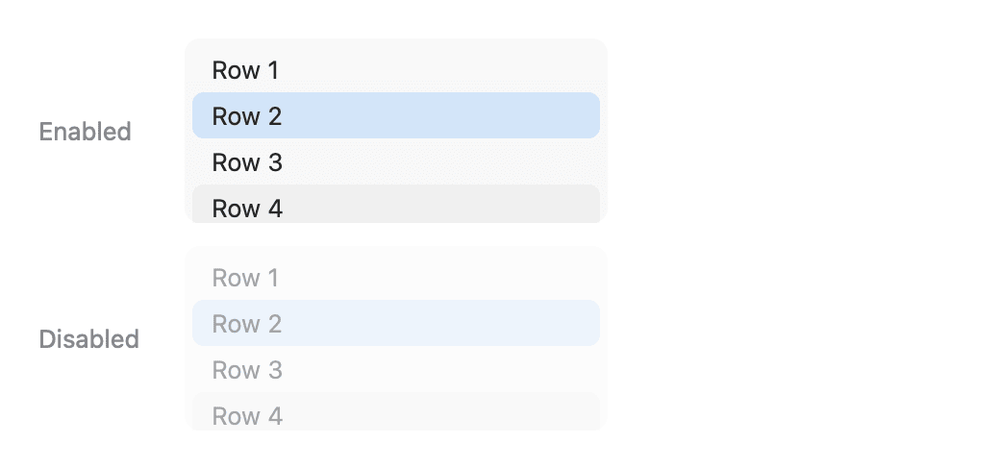

### List behavior

SwiftUI: `List(rows, selection: $sel) { … }.listRowBackground(…)`

```rust
let t = ui.theme();
let (id, key) = (Id::of("own list"), |i: usize| i as u64);
let b = ui.list_behavior(id, ListRows::new(40, 22.0), &mut self.own_rows, &key);
let sel = b.selection();

// The box's focus and the rows built in view, their ids the list's.
let style = Style::new().w(px(220.0)).h(px(96.0)).pad(4.0).radius(8.0).bg(t.panel());
let style = b.style(style);
ui.with_id(id).scroll_area(style, |ui| {
  ui.list_rows(&b, |ui, i, k| {
    let on = sel.contains(k);
    let row = Style::new().w(grow()).h(px(22.0)).pad_xy(8.0, 0.0).radius(5.0);
    let fill = if on { t.accent() } else { [0.0; 4] };
    let row = row.align(Align::Start, Align::Center).bg(fill);
    let text = TextStyle::new(t.font(), if on { t.on_accent() } else { t.text() });
    ui.with_id(id.key(("row", k)))
      .row(row, |ui| ui.text(format_args!("Row {}", i + 1), text));
  });
});
```

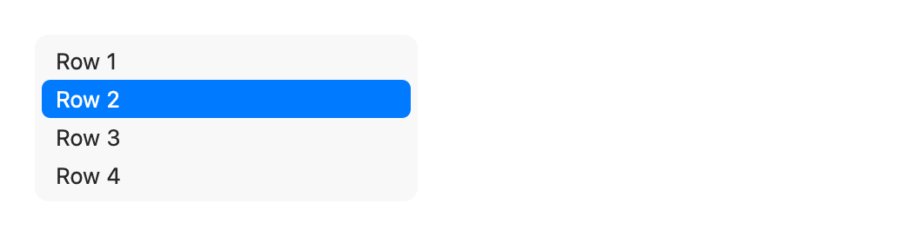

## Containers

### Tabs

SwiftUI: `TabView { … }`

```rust
ui.col(Style::new().w(px(300.0)).h(px(90.0)), |ui| {
  Tabs::new(&mut self.tab, &["General", "Advanced"]).show(ui, |ui, i| {
    ui.label(["The general page", "The advanced page"][i]);
  });
});
```


### Split

SwiftUI: `HSplitView { … }`

```rust
let t = ui.theme();
ui.row(Style::new().w(px(260.0)).h(px(60.0)), |ui| {
  Split::new(Axis::Horizontal).ratio(&mut self.side).show(ui, |ui, pane| {
    ui.text(["Sidebar", "Content"][pane], t.label());
  });
});
```


### Navigation split

SwiftUI: `NavigationSplitView { Sidebar().navigationSplitViewColumnWidth(min: 80, ideal: 104, max: 180) } detail: { … }`

```rust
let t = ui.theme();
ui.row(Style::new().w(px(260.0)).h(px(60.0)), |ui| {
  let split = Split::navigation().ratio(&mut self.side).min(80.0, 80.0);
  split.max(180.0, f32::INFINITY).show(ui, |ui, pane| {
    let ground = if pane == 0 { t.panel() } else { t.bg() };
    ui.col(Style::new().grow().pad(8.0).bg(ground), |ui| {
      ui.text(["Sidebar", "Detail"][pane], t.label())
    });
  });
});
```


### Toolbar

SwiftUI: `Detail().toolbar { ToolbarItem(placement: .principal) { … }; ToolbarItem(placement: .primaryAction) { … } } in a NavigationSplitView`

```rust
let t = ui.theme();
let bar = Style::new().w(px(360.0)).h(px(52.0)).radius(8.0).pad(1.0).clip().bg(t.bg());
ui.row(bar.border(1.0, t.line()), |ui| {
  Split::navigation().ratio(&mut self.bar_side).show(ui, |ui, pane| {
    let ground = if pane == 0 { t.panel() } else { t.bg() };
    ui.col(Style::new().grow().bg(ground), |ui| {
      // The sidebar's toggle at its trailing edge; the detail's title in its centre and
      // its action at its end.
      ui.toolbar(|ui| match pane {
        0 => ui.toolbar_item(ToolbarItemPlacement::Navigation, |ui| {
          _ = ui.help("Hide Sidebar").icon_button(Icon::SIDEBAR)
        }),
        _ => {
          ui.toolbar_item(ToolbarItemPlacement::Principal, |ui| ui.label("Notes"));
          ui.toolbar_item(ToolbarItemPlacement::PrimaryAction, |ui| {
            _ = ui.help("New Note").icon_button(Icon::DOC)
          });
        }
      });
    });
  });
});
```

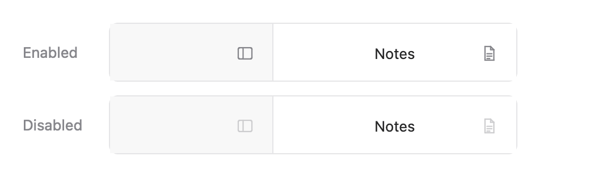

### Unified toolbar

SwiftUI: `.windowToolbarStyle(.unified)`

```rust
let t = ui.theme();
let band = Style::new().w(px(360.0)).h(px(52.0)).radius(8.0).pad_xy(12.0, 0.0);
let band = band.gap(8.0).align(Align::Start, Align::Center).bg(t.panel());
ui.window_toolbar_style(WindowToolbarStyle::Unified);
ui.row(band, |ui| {
  ui.text("Notes", t.label());
  ui.spacer();
  _ = ui.help("New Note").icon_button(Icon::DOC);
});
```

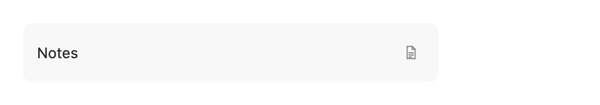

### Menu

SwiftUI: `Menu("Actions") { Button(…) }`

```rust
ui.menu("Actions", |ui| {
  ui.menu_item("Copy");
  ui.menu_item("Paste");
});
```


### Lazy column

SwiftUI: `ScrollView { LazyVStack { ForEach(0..<1000) { i in … } } }`

```rust
let t = ui.theme();
let area = Style::new().w(px(200.0)).h(px(98.0)).radius(8.0).border(1.0, t.line());
let row = |ui: &mut Ui, i: usize| {
  let s = Style::new().w(grow()).h(px(24.0)).pad_xy(10.0, 0.0);
  ui.row(s.align(Align::Start, Align::Center), |ui| {
    ui.text(format_args!("Row {} of 1000", i + 1), t.label())
  });
};
ui.scroll_area(area.bg(t.panel()), |ui| ui.lazy_col(Style::new(), 1000, |i| i, row));
```

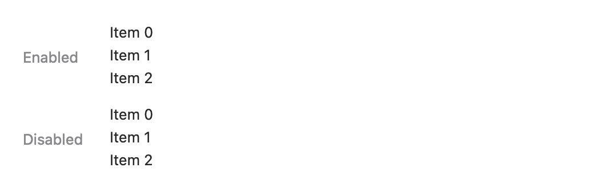

### Scroll behavior

SwiftUI: `ScrollView { … }.scrollIndicators(.hidden).onScrollGeometryChange(…) { … }`

```rust
let t = ui.theme();
let id = Id::of("own scroll");
let b = ui.scroll_behavior(id, Axes::VERTICAL);

// Four of twenty lines in view, 24 points each inside a border of 1.
let area = Style::new().w(px(200.0)).h(px(98.0)).radius(8.0).border(1.0, t.line());
ui.with_id(id).col(area.bg(t.panel()).scroll(Axes::VERTICAL), |ui| {
  for i in 1..=20 {
    let line = Style::new().w(grow()).h(px(24.0)).pad_xy(10.0, 0.0);
    ui.row(line.align(Align::Start, Align::Center), |ui| {
      ui.text(format_args!("Line {i}"), t.label())
    });
  }

  let Some(bar) = b.bar(Axis::Vertical) else { return };
  let at =
    Float::parent().attach(UnitPoint::TOP_TRAILING).anchor(UnitPoint::TOP_TRAILING);
  let at = at.offset(-ScrollBar::INSET, ScrollBar::INSET + bar.pos);
  let thumb = Style::new().w(px(4.0)).h(px(bar.thumb)).radius(2.0).bg(t.accent());
  ui.with_id(b.thumb(Axis::Vertical)).float(at).el(thumb);
});
```

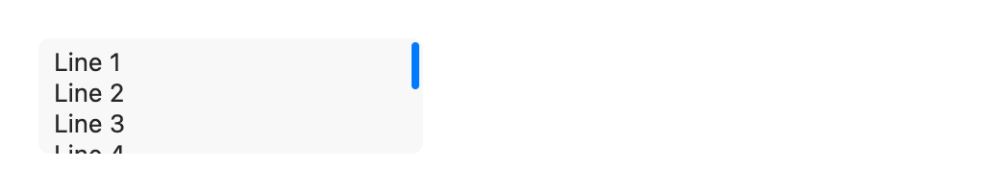

### Scroll indicators

SwiftUI: `NSScroller.knobStyle = .light (AppKit; SwiftUI has none)`

```rust
let t = ui.theme();
let red = ScrollerKnob::DARK.color(alpha(t.danger(), 0.6));
let old = ui.set_environment(Some(red));
let area = Style::new().w(px(200.0)).h(px(98.0)).radius(8.0).border(1.0, t.line());
ui.scroll_area(area.bg(t.panel()), |ui| {
  for i in 1..=20 {
    let line = Style::new().w(grow()).h(px(24.0)).pad_xy(10.0, 0.0);
    ui.row(line.align(Align::Start, Align::Center), |ui| {
      ui.text(format_args!("Line {i}"), t.label())
    });
  }
});
ui.set_environment(old);
```


### Stack queries

SwiftUI: `Divider() follows its stack's axis (SwiftUI has no API for it)`

```rust
let t = ui.theme();
let read = |ui: &mut Ui| {
  let (axis, n) = (ui.parent_axis(), ui.child_count());
  if let Some(axis) = axis {
    ui.text(format_args!("{axis:?}, {n} before"), t.label());
  }
};
ui.row(Style::new().gap(8.0), |ui| (0..2).for_each(|_| read(ui)));
ui.col(Style::new().gap(4.0), |ui| (0..2).for_each(|_| read(ui)));
```


## Presentation

### Alert

SwiftUI: `.alert("Delete?", isPresented: $ask) { Button("Delete", role: .destructive) }`

```rust
let t = ui.theme();
if ui.button("Delete…").clicked {
  self.ask = true;
}

ui.text(format_args!("Deleted {} times", self.deleted), t.muted().nowrap());
let d =
  Dialog::new("Delete the file?").message("It moves to the Trash.").icon(Icon::TRASH);
let d = d.button("Delete", ButtonRole::Destructive);
if d.show(ui.id(DIALOG), &mut self.ask) == Some(Answer::Action) {
  self.deleted += 1;
}
```

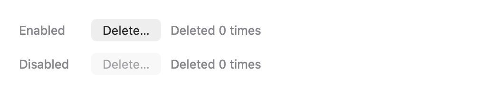

### Context menu

SwiftUI: `.contextMenu { Button("Copy") { … } }`

```rust
let r = ui.button("Right-click me");
let menu = || {
  let delete = Item::button(Action::Delete, "Delete").role(ButtonRole::Destructive);
  Menu::new(vec![Item::button(Action::Copy, "Copy"), Item::Divider, delete])
};
if ui.context_menu(r.id, menu) == Some(Action::Copy) {
  self.copied += 1;
}
```

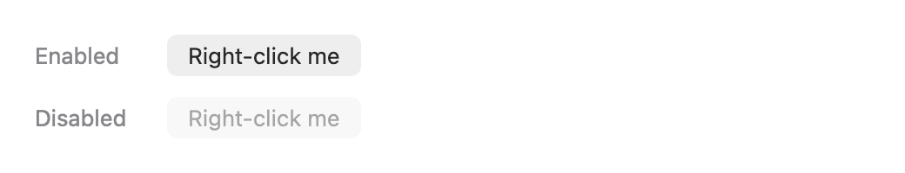

### Menu bar

SwiftUI: `.commands { CommandMenu("Track") { Button("Play") { … } }; CommandGroup(replacing: .newItem) { … } }`

```rust
let t = ui.theme();
ui.text("File, Edit, View, Track, Window and Help in the menu bar (macOS)", t.label());
```


### Tooltip

SwiftUI: `.help("Saves it")`

```rust
ui.help("Saves it").button("Save");
```


### Custom help style

SwiftUI: `.help("Saves it") (SwiftUI has no help style)`

```rust
/// The tip on the accent in small white text.
struct Note;

impl HelpStyle for Note {
  fn make_body(&self, ui: &mut Ui, c: HelpConfiguration) {
    let t = ui.theme();
    let s =
      Style::new().pad_xy(8.0, 4.0).radius(6.0).bg(t.accent()).opacity(c.opacity());
    ui.row(s, |ui| ui.text(c.text(), TextStyle::new(t.small(), t.on_accent())));
  }
}

ui.help_style(&Note);
ui.help("Saves it").button("Save");
ui.help("Opens it").button("Open");
```


## Modifiers

### Disabled

SwiftUI: `.disabled(true)`

```rust
ui.button("Save");
ui.toggle(&mut self.on, ());
```


### Control size

SwiftUI: `.controlSize(.small)`

```rust
ui.button("Save");
ui.toggle(&mut self.on, ());
ui.badge("Beta", Tone::Neutral);
```


### Accessibility label

SwiftUI: `.accessibilityLabel("Reset")`

```rust
ui.a11y_label("Reset").icon_button(Icon::RESET);
```


### Keyboard shortcut

SwiftUI: `Button("Count") { … }.keyboardShortcut("k", modifiers: .command)`

```rust
const KEYS: &[Binding] =
  &[Binding::new(Shortcut::char('k').cmd(), Command::Action("count"))];
let t = ui.theme();
let id = ui.take_id();
if ui.command(id) == Some(Command::Action("count")) {
  self.counted += 1;
}

let keys = Shortcut::char('k').cmd().label();
let s = Style::new().h(px(28.0)).pad_xy(10.0, 0.0).center().radius(6.0);
ui.keymap(KEYS).with_id(id).row(s.bg(t.raised()).focusable(), |ui| {
  ui.text(format_args!("{keys} pressed: {}", self.counted), t.label())
});
```


### Environment

SwiftUI: `.environment(\.tint, .green) { … }; @Environment(\.tint) var tint`

```rust
/// The tint of the swatches built while it is there, the theme's raised colour by
/// default.
#[derive(Clone, Copy)]
struct Tint(Color);

impl EnvironmentValue for Tint {
  fn default_value(ui: &Ui) -> Self {
    Self(ui.theme().raised())
  }
}

let t = ui.theme();
let tile = |ui: &mut Ui| {
  let tint = ui.environment_value::<Tint>().0;
  ui.el(Style::new().w(px(28.0)).h(px(28.0)).radius(6.0).bg(tint));
};
tile(ui);
let row = Style::new().gap(10.0).align(Align::Start, Align::Center);
ui.environment(Tint(t.success())).row(row, |ui| (0..2).for_each(|_| tile(ui)));
```


### Group

SwiftUI: `Group { Button("Save"); Toggle(…) }.disabled(true)`

```rust
ui.disabled(true).group(|ui| {
  ui.button("Save");
  ui.toggle(&mut self.on, ());
});
ui.button("Open");
```


### Identity

SwiftUI: `Box().id(item.id); .allowsHitTesting(false)`

```rust
let t = ui.theme();
let square = Style::new().w(px(28.0)).h(px(28.0)).radius(6.0);
(0..3).for_each(|k| _ = ui.key(k).el(square.bg(t.raised())));
ui.with_id(Id::of("identity").key("box"))
  .allows_hit_testing(false)
  .el(square.bg(t.accent()));
```


### Focus and pointer

SwiftUI: `.focusable(); .pointerStyle(.link)`

```rust
let t = ui.theme();
let id = Id::of("focus and pointer");
let square = Style::new().w(px(28.0)).h(px(28.0)).radius(6.0);
ui.with_id(id).focusable(true).pointer_style(Cursor::Pointer).el(square.bg(t.accent()));
ui.with_id(id.key("not")).focusable(false).el(square.bg(t.raised()).focusable());
```


### Widget parts

SwiftUI: `.environment(\.isEnabled, true); .help(tip) on a part`

```rust
ui.button("Save");
let tip = ui.help("Always enabled").take_help();
if let Some(tip) = &tip {
  ui.help(tip);
}

ui.environment(Enabled(true)).button("Undo");
```


### Frame request

SwiftUI: `TimelineView(.animation) { context in … }`

```rust
let t = ui.theme();
ui.request_frame();
let k = ui.now().as_secs_f32() % 1.0;
let bar = Style::new().w(px(28.0 + 120.0 * k)).h(px(28.0)).radius(6.0);
ui.el(bar.bg(t.accent()));
```


### Accessibility pair

SwiftUI: `.accessibilityLabeledPair(role: .label, id: "volume", in: ns)`

```rust
let pair = Id::of("volume");
ui.a11y_labeled_pair(LabeledPairRole::Label, pair, |ui| ui.label("Volume"));
ui.a11y_labeled_pair(LabeledPairRole::Content, pair, |ui| {
  ui.col(Style::new().w(px(160.0)), |ui| ui.slider(&mut self.level, 0.0..=100.0));
});
ui.badge("New", Tone::Accent);
```

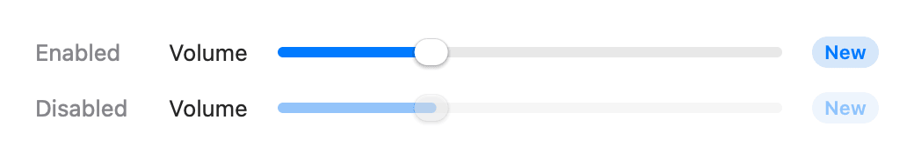

### Controls theme

SwiftUI: `@Environment(\.controlActiveState) var state`

```rust
let c = ui.controls_theme();
ui.el(Style::new().w(px(28.0)).h(px(28.0)).radius(6.0).bg(c.accent()));
ui.toggle(&mut self.on, ());
```

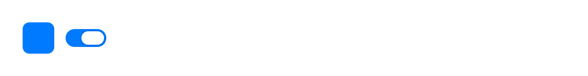

### Color scheme

SwiftUI: `@Environment(\.colorScheme) var colorScheme`

```rust
let t = ui.theme();
let name = if ui.color_scheme().is_dark() { "Dark" } else { "Light" };
ui.text(name, t.label());
```


