# nimbo and SwiftUI

Each building block of nimbo beside its SwiftUI counterpart, as the gallery shows it live (`cargo run --release --example gallery`, a page per block in its variants). A block aims at its SwiftUI counterpart's behaviour and API shape without copying it 1:1. Its line is the call that makes it, taken from the gallery's code for the block, which builds what the picture shows and is a link away. The pictures are the gallery's, in the light appearance, kept on the repo's `assets` branch: `make api-shots` makes them and this file again from the gallery's table (`examples/gallery.rs`), so a block changes there.

On macOS SwiftUI's `List` has neither of the grouped styles (`InsetGroupedListStyle` and `GroupedListStyle` are iOS's): nimbo's `InsetGroupedListStyle` takes the iOS name for the plates of the grouped `Form` (`.formStyle(.grouped)`), which its sections share.

## Layout

### Row

SwiftUI: `HStack(alignment: .top, spacing: 8) { … }`

```rust
ui.row(Style::new().gap(8.0).align(Align::Start, Align::Start), |ui| { … })
```

[The block's code](https://github.com/vladkens/nimbo/blob/main/examples/gallery.rs#L996-L1009)


### Column

SwiftUI: `VStack(alignment: .leading, spacing: 6) { … }`

```rust
ui.col(Style::new().gap(6.0).align(Align::Start, Align::Start), |ui| { … })
```

[The block's code](https://github.com/vladkens/nimbo/blob/main/examples/gallery.rs#L1012-L1025)


### Grid

SwiftUI: `Grid(horizontalSpacing: 6, verticalSpacing: 6) { GridRow { … } }; .gridCellColumns(2)`

```rust
ui.grid(3, Style::new().w(px(132.0)).gap(6.0), |ui| {
  ui.span(2).row(key, |ui| …);
})
```

[The block's code](https://github.com/vladkens/nimbo/blob/main/examples/gallery.rs#L1028-L1039)


### Spacer

SwiftUI: `HStack { Text("Notes"); Spacer(); Button("Share") { … } }`

```rust
ui.text("Notes", t.label());
ui.spacer();
ui.button("Share");
```

[The block's code](https://github.com/vladkens/nimbo/blob/main/examples/gallery.rs#L1042-L1060)


### Divider

SwiftUI: `HStack { Text("Cut"); Divider(); Text("Copy") }; VStack { …; Divider(); … }`

```rust
ui.row(…, |ui| { … ui.divider(); … })
ui.col(…, |ui| { … ui.divider(); … })
```

[The block's code](https://github.com/vladkens/nimbo/blob/main/examples/gallery.rs#L1063-L1081)


### Scroll view

SwiftUI: `ScrollView(.vertical) { … }`

```rust
ui.scroll_area(Style::new().scroll(Axes::VERTICAL), |ui| { … })
```

[The block's code](https://github.com/vladkens/nimbo/blob/main/examples/gallery.rs#L1084-L1095)


### Scroll anchor

SwiftUI: `ScrollView { LazyVStack { … } }.defaultScrollAnchor(.bottom)`

```rust
ui.default_scroll_anchor(UnitPoint::BOTTOM).scroll_area(area, |ui| { … })
```

[The block's code](https://github.com/vladkens/nimbo/blob/main/examples/gallery.rs#L1098-L1117)


### Content margins

SwiftUI: `ScrollView { … }.contentMargins(.top, 28).contentMargins(.bottom, 8)`

```rust
ui.content_margins([28.0, 0.0, 8.0, 0.0], ContentMarginPlacement::Automatic)
  .scroll_area(area, |ui| { … })
```

[The block's code](https://github.com/vladkens/nimbo/blob/main/examples/gallery.rs#L1119-L1134)


### Overlay

SwiftUI: `.overlay(alignment: .topTrailing) { … }`

```rust
ui.float(Float::parent().attach(at).anchor(at).offset(-4.0, 4.0)).el(dot)
```

[The block's code](https://github.com/vladkens/nimbo/blob/main/examples/gallery.rs#L1136-L1144)


## Text

### Text

SwiftUI: `Text("Title").font(.headline).foregroundStyle(.secondary)`

```rust
ui.text("Title", TextStyle::new(t.bold(), t.text()))
```

[The block's code](https://github.com/vladkens/nimbo/blob/main/examples/gallery.rs#L1558-L1563)


### Localized text

SwiftUI: `Text("Keep the history"); String(localized: "\(name) is not on disk")`

```rust
ui.text(t!("Keep the history"), …)
ui.text(t!("{name} is not on disk", name), …)
```

[The block's code](https://github.com/vladkens/nimbo/blob/main/examples/gallery.rs#L1565-L1573)


### Line limit

SwiftUI: `Text(path).lineLimit(1).truncationMode(.middle)`

```rust
ui.text(path, t.body().truncation(TruncationMode::Middle))
```

[The block's code](https://github.com/vladkens/nimbo/blob/main/examples/gallery.rs#L1575-L1583)


### Underline

SwiftUI: `Text("WER").underline(pattern: .dot)`

```rust
ui.text(n, t.label().underline(LinePattern::Dot))
```

[The block's code](https://github.com/vladkens/nimbo/blob/main/examples/gallery.rs#L1584-L1598)


### Styled text

SwiftUI: `Text("fn ").foregroundStyle(.pink).bold() + Text("main").italic(); Text(attributedString).textSelection(.enabled)`

```rust
prose.push("in bold", a.weight(Weight::Bold)).push("italic", a.italic());
ui.text(&prose, t.body())
```

[The block's code](https://github.com/vladkens/nimbo/blob/main/examples/gallery.rs#L1601-L1636)


### Selectable text

SwiftUI: `Text(log).textSelection(.enabled)`

```rust
ui.selectable_text("Select this text and copy it.", t.body())
```

[The block's code](https://github.com/vladkens/nimbo/blob/main/examples/gallery.rs#L1638-L1643)

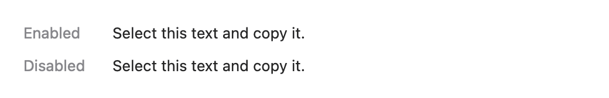

### Link

SwiftUI: `Link("Learn more", destination: url)`

```rust
ui.link("Learn more…")
```

[The block's code](https://github.com/vladkens/nimbo/blob/main/examples/gallery.rs#L1645-L1647)


### Image

SwiftUI: `Image(systemName: "gear")`

```rust
ui.icon(icon.stroke(1.6), 20.0, t.text())
```

[The block's code](https://github.com/vladkens/nimbo/blob/main/examples/gallery.rs#L1648-L1653)


### Label content

SwiftUI: `Label { Text(title) } icon: { Image(systemName: "folder") }; configuration.label in a style`

```rust
let labels: [Content; 3] = [Icon::FOLDER.into(), "Data folder".into(), Icon::INFO.into()];
label.build(ui, t.label())
```

[The block's code](https://github.com/vladkens/nimbo/blob/main/examples/gallery.rs#L1656-L1664)


### Photo

SwiftUI: `Image(nsImage: NSImage(data: file)!).resizable().aspectRatio(contentMode: .fill).frame(width: 80, height: 80).clipped()`

```rust
ui.aspect_ratio(ContentMode::Fill).image(photo, square)
```

[The block's code](https://github.com/vladkens/nimbo/blob/main/examples/gallery.rs#L1666-L1675)


## Controls

### Button

SwiftUI: `Button("Save") { … }.buttonStyle(.borderedProminent)`

```rust
ui.button_style(&BorderedProminentButtonStyle).button("Prominent")
```

[The block's code](https://github.com/vladkens/nimbo/blob/main/examples/gallery.rs#L524-L528)


### Button role

SwiftUI: `Button("Delete", role: .destructive) { … }`

```rust
Button::new("Delete").role(ButtonRole::Destructive).show(ui)
```

[The block's code](https://github.com/vladkens/nimbo/blob/main/examples/gallery.rs#L529-L533)

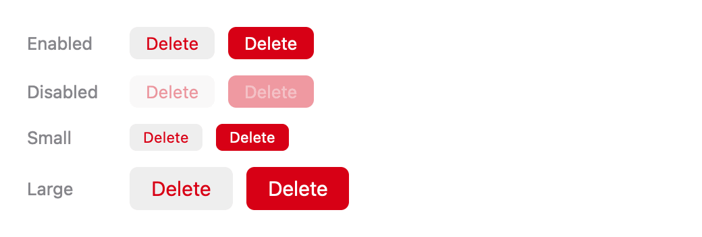

### Icon button

SwiftUI: `Button { Image(systemName: "trash") }.buttonStyle(.borderless)`

```rust
ui.icon_button(Icon::TRASH)
```

[The block's code](https://github.com/vladkens/nimbo/blob/main/examples/gallery.rs#L535-L538)

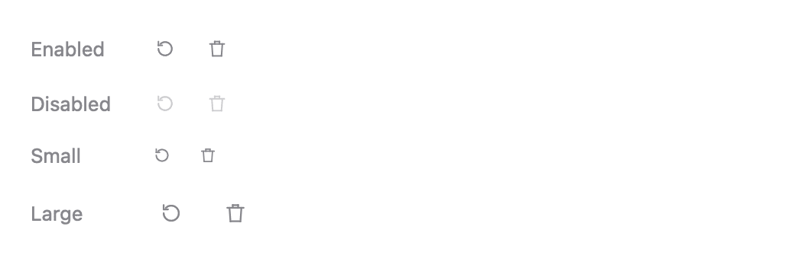

### Button style

SwiftUI: `HStack { Button("Cut") { … }; Button("Copy") { … } }.buttonStyle(.borderless)`

```rust
ui.button_style(&BorderlessButtonStyle).row(row, |ui| { … })
```

[The block's code](https://github.com/vladkens/nimbo/blob/main/examples/gallery.rs#L541-L548)


### Custom button style

SwiftUI: `struct Pill: ButtonStyle { func makeBody(configuration: Configuration) -> some View { configuration.label.padding(…).background(…) } }`

```rust
impl ButtonStyle for Pill {
  fn make_body(&self, ui: &mut Ui, mut c: ButtonConfiguration) { … }
}
```

[The block's code](https://github.com/vladkens/nimbo/blob/main/examples/gallery.rs#L549-L568)

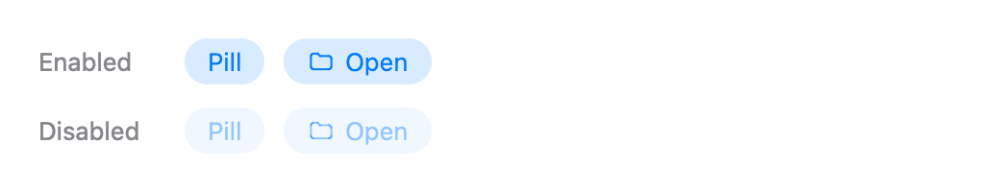

### Switch

SwiftUI: `Toggle("Live", isOn: $live)`

```rust
ui.toggle(&mut self.live, "Live")
```

[The block's code](https://github.com/vladkens/nimbo/blob/main/examples/gallery.rs#L570-L572)


### Check box

SwiftUI: `Toggle("Wrap", isOn: $wrap).toggleStyle(.checkbox)`

```rust
ui.toggle_style(&CheckboxToggleStyle).toggle(&mut self.wrap, "Wrap")
```

[The block's code](https://github.com/vladkens/nimbo/blob/main/examples/gallery.rs#L573-L575)


### Button toggle

SwiftUI: `Toggle("Bold", isOn: $bold).toggleStyle(.button)`

```rust
ui.toggle_style(&ButtonToggleStyle).toggle(&mut self.bold, "Bold")
```

[The block's code](https://github.com/vladkens/nimbo/blob/main/examples/gallery.rs#L576-L579)


### Toggle style

SwiftUI: `VStack { Toggle("Wrap", …); Toggle("Numbers", …) }.toggleStyle(.checkbox)`

```rust
ui.toggle_style(&CheckboxToggleStyle).col(Style::new().gap(6.0), |ui| { … })
```

[The block's code](https://github.com/vladkens/nimbo/blob/main/examples/gallery.rs#L582-L588)


### Custom toggle style

SwiftUI: `struct Dot: ToggleStyle { func makeBody(configuration: Configuration) -> some View { HStack { Circle()…; configuration.label } } }`

```rust
impl ToggleStyle for Dot {
  fn make_body(&self, ui: &mut Ui, mut c: ToggleConfiguration) { … }
}
```

[The block's code](https://github.com/vladkens/nimbo/blob/main/examples/gallery.rs#L589-L613)


### Slider

SwiftUI: `Slider(value: $zoom, in: 0...200)`

```rust
ui.slider(&mut self.zoom, 0.0..=200.0)
```

[The block's code](https://github.com/vladkens/nimbo/blob/main/examples/gallery.rs#L616-L621)


### Slider steps

SwiftUI: `Slider(value: $level, in: 10...90, step: 10) { … } tick: { v in SliderTick(v) { … } }`

```rust
Slider::new(&mut self.level, 10.0..=90.0).step(10.0).show(ui)
```

[The block's code](https://github.com/vladkens/nimbo/blob/main/examples/gallery.rs#L622-L627)


### Slider style

SwiftUI: `Slider(value: $zoom, in: 0...200) (SwiftUI has no slider style)`

```rust
ui.slider_style(&PlainSliderStyle).col(Style::new().w(grow()), |ui| { … })
```

[The block's code](https://github.com/vladkens/nimbo/blob/main/examples/gallery.rs#L630-L637)


### Custom slider style

SwiftUI: `struct Meter: ProgressViewStyle { … } (SwiftUI has no slider style)`

```rust
impl SliderStyle for Meter {
  fn make_body(&self, ui: &mut Ui, c: SliderConfiguration) { … }
}
```

[The block's code](https://github.com/vladkens/nimbo/blob/main/examples/gallery.rs#L638-L668)


### Picker

SwiftUI: `Picker("Size", selection: $size) { …; Divider(); … }`

```rust
Picker::new(&mut self.size).options(&SIZES).show(ui)
```

[The block's code](https://github.com/vladkens/nimbo/blob/main/examples/gallery.rs#L670-L673)


### Segmented picker

SwiftUI: `Picker(…) { … }.pickerStyle(.segmented)`

```rust
ui.picker_style(&SegmentedPickerStyle).picker(&mut self.view, &views)
```

[The block's code](https://github.com/vladkens/nimbo/blob/main/examples/gallery.rs#L674-L681)


### Picker style

SwiftUI: `VStack { Picker(…) { … } }.pickerStyle(.inline); Picker(…) { … }`

```rust
ui.picker_style(&InlinePickerStyle).row(row, |ui| { … })
```

[The block's code](https://github.com/vladkens/nimbo/blob/main/examples/gallery.rs#L684-L690)


### Custom picker style

SwiftUI: `struct Chips: PickerStyle (SwiftUI's is closed: its styles are the system's)`

```rust
impl PickerStyle for Chips {
  fn make_body(&self, ui: &mut Ui, mut c: PickerConfiguration) { … }
}
```

[The block's code](https://github.com/vladkens/nimbo/blob/main/examples/gallery.rs#L691-L722)


### Text field

SwiftUI: `TextField("Name", text: $name)`

```rust
ui.text_field(&mut self.name, "Name")
```

[The block's code](https://github.com/vladkens/nimbo/blob/main/examples/gallery.rs#L724-L726)

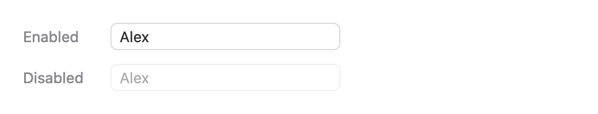

### Multi-line field

SwiftUI: `TextField("Notes", text: $notes, axis: .vertical)`

```rust
TextField::new(&mut self.notes, "Notes").axis(Axis::Vertical).show(ui)
```

[The block's code](https://github.com/vladkens/nimbo/blob/main/examples/gallery.rs#L728-L732)


### Secure field

SwiftUI: `SecureField("Password", text: $key)`

```rust
ui.secure_field(&mut self.key, "Password")
```

[The block's code](https://github.com/vladkens/nimbo/blob/main/examples/gallery.rs#L733-L735)


### Search field

SwiftUI: `.searchable(text: $query)`

```rust
ui.search_field(&mut self.query, "Search")
```

[The block's code](https://github.com/vladkens/nimbo/blob/main/examples/gallery.rs#L736-L738)

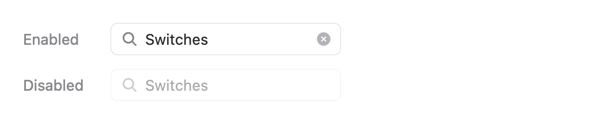

### Date picker

SwiftUI: `DatePicker("Start", selection: $start, in: ...end, displayedComponents: .date)`

```rust
DatePicker::new(&mut self.start).range(..=end).show(ui)
```

[The block's code](https://github.com/vladkens/nimbo/blob/main/examples/gallery.rs#L742-L745)


### Date picker style

SwiftUI: `DatePicker(…).datePickerStyle(.field)`

```rust
ui.date_picker_style(&FieldDatePickerStyle).date_picker(&mut self.start)
```

[The block's code](https://github.com/vladkens/nimbo/blob/main/examples/gallery.rs#L746-L750)


### Character palette

SwiftUI: `NSApp.orderFrontCharacterPalette(nil), Edit ▸ Emoji & Symbols (AppKit; SwiftUI has none)`

```rust
ui.character_palette()
```

[The block's code](https://github.com/vladkens/nimbo/blob/main/examples/gallery.rs#L754-L759)


### Text field style

SwiftUI: `VStack { TextField("Name", text: $name); TextField("City", text: $city) }.textFieldStyle(.plain)`

```rust
ui.text_field_style(&PlainTextFieldStyle).col(col, |ui| { … })
```

[The block's code](https://github.com/vladkens/nimbo/blob/main/examples/gallery.rs#L762-L769)


### Custom text field style

SwiftUI: `struct Underline: TextFieldStyle { func _body(configuration: TextField<_Label>) -> some View { configuration.padding(…).overlay(alignment: .bottom) { … } } }`

```rust
impl TextFieldStyle for Underline {
  fn make_body(&self, ui: &mut Ui, mut c: TextFieldConfiguration) { … }
}
```

[The block's code](https://github.com/vladkens/nimbo/blob/main/examples/gallery.rs#L770-L791)


### Progress

SwiftUI: `ProgressView(value: 0.42)`

```rust
ui.progress(Some(0.42))
```

[The block's code](https://github.com/vladkens/nimbo/blob/main/examples/gallery.rs#L793-L796)


### Spinner

SwiftUI: `ProgressView()`

```rust
ui.spinner()
```

[The block's code](https://github.com/vladkens/nimbo/blob/main/examples/gallery.rs#L797-L799)

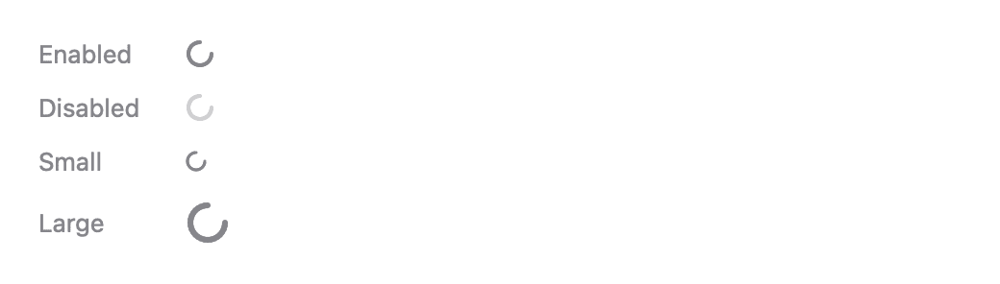

### Badge

SwiftUI: `.badge("New")`

```rust
ui.badge("New", Tone::Accent)
```

[The block's code](https://github.com/vladkens/nimbo/blob/main/examples/gallery.rs#L800-L806)


### Hotkey recorder

SwiftUI: `KeyboardShortcut (SwiftUI has no recorder)`

```rust
ui.hotkey_recorder(&mut self.hotkey)
```

[The block's code](https://github.com/vladkens/nimbo/blob/main/examples/gallery.rs#L808-L815)


### Control behavior

SwiftUI: `Button(action:) { … }.buttonStyle(MyStyle()), a look of the app's own`

```rust
let b = ui.button_behavior(id);
ui.control(&b).canvas(s, move |f, r| { … })
```

[The block's code](https://github.com/vladkens/nimbo/blob/main/examples/gallery.rs#L818-L840)

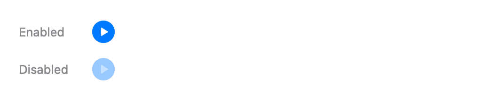

### Help marks

SwiftUI: `Image(systemName: "info.circle").help(tip); HelpLink { … }`

```rust
ui.help(…).info_button()
ui.help(…).help_button()
```

[The block's code](https://github.com/vladkens/nimbo/blob/main/examples/gallery.rs#L842-L846)


## Form

### Section

SwiftUI: `Section { … } header: { … } footer: { … }`

```rust
let section = Section::new(head).footer("Kept until you clear it.");
ui.form_section(&fs, section, |ui| { … })
```

[The block's code](https://github.com/vladkens/nimbo/blob/main/examples/gallery.rs#L867-L881)


### Form row

SwiftUI: `LabeledContent { Toggle(isOn: $on) {} } label: { Text(title); Text(subtitle) }`

```rust
FormRow::new("Open at login").caption("Starts with your Mac, in the menu bar.")
ui.form_row(&fs, row, |ui| ui.toggle(&mut self.on, ()))
```

[The block's code](https://github.com/vladkens/nimbo/blob/main/examples/gallery.rs#L883-L893)

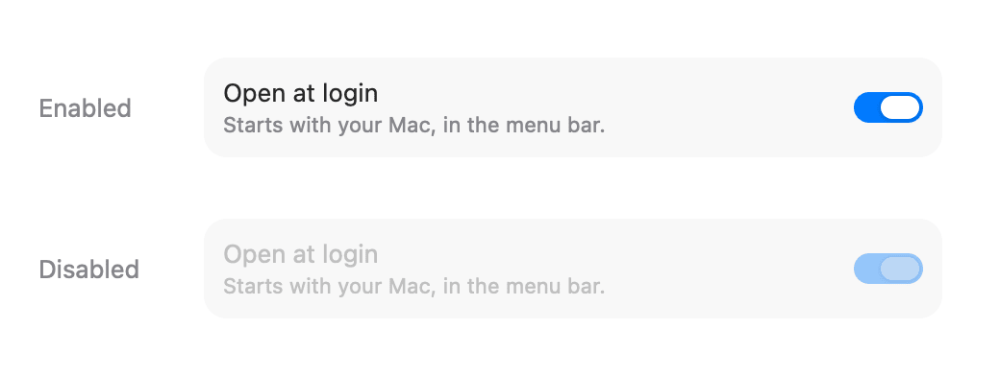

### Composed label

SwiftUI: `label: { Text(name); Text("New").badge(…) }`

```rust
let label = |ui: &mut Ui, s: TextStyle| {
  ui.text("gigaam-v3", s.line_limit(1)); … ui.badge("Recommended", Tone::Accent);
};
```

[The block's code](https://github.com/vladkens/nimbo/blob/main/examples/gallery.rs#L895-L915)

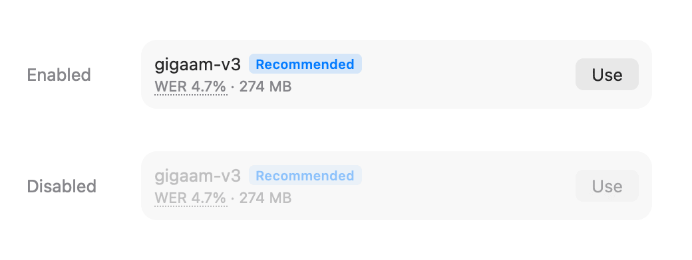

### Row tile

SwiftUI: `Label { Text(title) } icon: { Image(systemName: "folder") }`

```rust
let row = FormRow::new("Data folder").caption("~/Library/Application Support");
ui.form_row(&fs, row.tile(Icon::FOLDER), |ui| ui.button("Show"))
```

[The block's code](https://github.com/vladkens/nimbo/blob/main/examples/gallery.rs#L917-L926)


### Row footer

SwiftUI: `Section { VStack { Toggle(…); Slider(…) } }`

```rust
let footer = |ui: &mut Ui, _: TextStyle| { … };
let row = FormRow::new(&name).caption("Only on battery.").footer(footer);
ui.form_row(&fs, row, |ui| ui.toggle(&mut self.on, ()))
```

[The block's code](https://github.com/vladkens/nimbo/blob/main/examples/gallery.rs#L928-L944)


### Disclosure

SwiftUI: `DisclosureGroup("Other models") { … }`

```rust
let row = FormRow::new("Other models").caption("2 more");
ui.form_disclosure(&fs, row, |ui| { … })
```

[The block's code](https://github.com/vladkens/nimbo/blob/main/examples/gallery.rs#L946-L957)

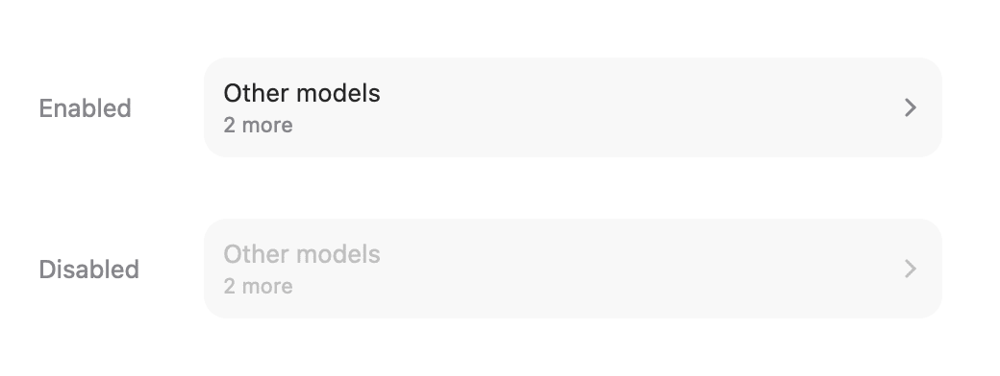

### Toolbar tabs

SwiftUI: `TabView(selection: $page) { General().tabItem { Label("General", systemImage: "gear") }.tag(Page.general) } in a Settings scene`

```rust
let tabs = [Tag::new(0, "General").icon(Icon::GEAR), …];
ui.toolbar_tabs(&fs, &mut self.tab, &tabs)
```

[The block's code](https://github.com/vladkens/nimbo/blob/main/examples/gallery.rs#L959-L965)


### Footer

SwiftUI: `HelpLink { … } at a pane's end`

```rust
ui.help("Help on these settings").form_footer(&fs, |ui| _ = ui.button("Reset All…"))
```

[The block's code](https://github.com/vladkens/nimbo/blob/main/examples/gallery.rs#L966-L975)

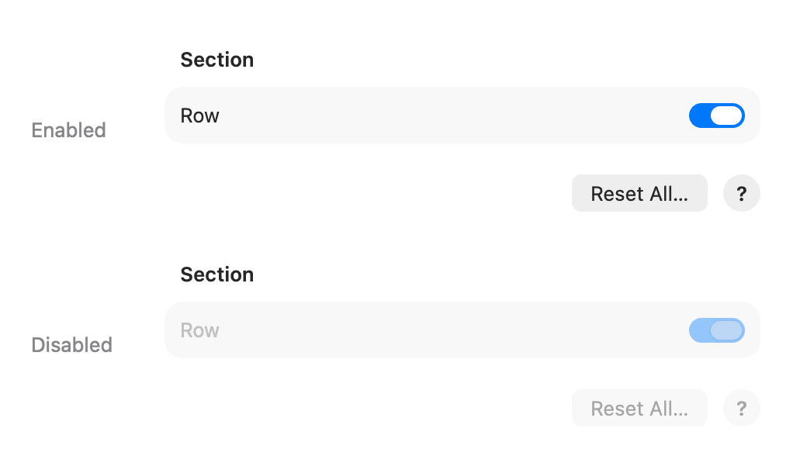

## List

### List

SwiftUI: `List(items, selection: $sel) { … }`

```rust
let list = List::new(40, 22.0).selection(&mut self.rows);
list.show(ui, |ui, row| …)
```

[The block's code](https://github.com/vladkens/nimbo/blob/main/examples/gallery.rs#L1165-L1170)


### List sections

SwiftUI: `Section(header:) in a List; .listStyle(…)`

```rust
let list = List::new(6, 30.0).sections(&[0, 3], 24.0, &head);
list.show(ui.list_style(&InsetGroupedListStyle), |ui, row| { … })
```

[The block's code](https://github.com/vladkens/nimbo/blob/main/examples/gallery.rs#L1245-L1253)


### List style

SwiftUI: `List(items, selection: $sel) { … }.listStyle(.plain)`

```rust
let plain = List::new(40, 22.0).style(frame).selection(plain_rows);
plain.show(ui.list_style(&PlainListStyle), |ui, row| { … })
```

[The block's code](https://github.com/vladkens/nimbo/blob/main/examples/gallery.rs#L1174-L1189)


### Custom list style

SwiftUI: `struct Stripes: ListStyle (SwiftUI's has no public makeBody)`

```rust
impl ListStyle for Stripes {
  fn make_body<'a>(&self, ui: &mut Ui<'a>, mut c: ListConfiguration<'_, 'a>) { … }
}
```

[The block's code](https://github.com/vladkens/nimbo/blob/main/examples/gallery.rs#L1190-L1220)


### List behavior

SwiftUI: `List(rows, selection: $sel) { … }.listRowBackground(…)`

```rust
let b = ui.list_behavior(id, ListRows::new(40, 22.0), &mut self.own_rows, &key);
ui.list_rows(&b, |ui, i, k| { … })
```

[The block's code](https://github.com/vladkens/nimbo/blob/main/examples/gallery.rs#L1223-L1243)


## Containers

### Tabs

SwiftUI: `TabView { … }`

```rust
Tabs::new(&mut self.tab, &["General", "Advanced"]).show(ui, |ui, i| { … })
```

[The block's code](https://github.com/vladkens/nimbo/blob/main/examples/gallery.rs#L332-L338)

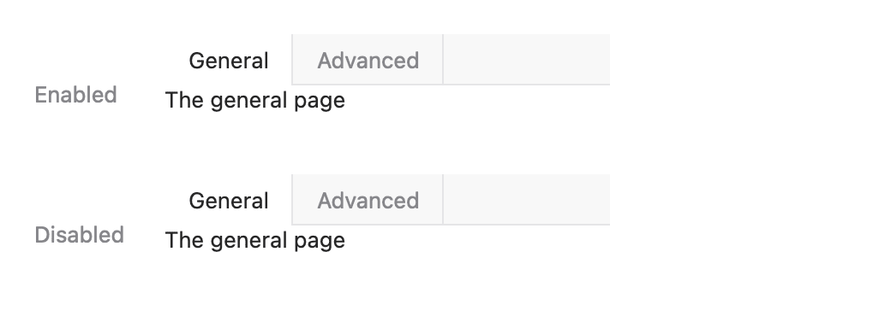

### Split

SwiftUI: `HSplitView { … }`

```rust
Split::new(Axis::Horizontal).ratio(&mut self.side).show(ui, |ui, pane| { … })
```

[The block's code](https://github.com/vladkens/nimbo/blob/main/examples/gallery.rs#L341-L359)


### Navigation split

SwiftUI: `NavigationSplitView { Sidebar().navigationSplitViewColumnWidth(min: 80, ideal: 104, max: 180) } detail: { … }`

```rust
let split = Split::navigation().ratio(&mut self.side).min(80.0, 80.0);
split.max(180.0, f32::INFINITY).show(ui, |ui, pane| { … })
```

[The block's code](https://github.com/vladkens/nimbo/blob/main/examples/gallery.rs#L361-L376)

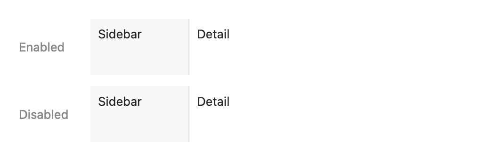

### Toolbar

SwiftUI: `Detail().toolbar { ToolbarItem(placement: .principal) { … }; ToolbarItem(placement: .primaryAction) { … } } in a NavigationSplitView`

```rust
ui.toolbar(|ui| …)
ui.toolbar_item(ToolbarItemPlacement::Principal, |ui| ui.label("Notes"))
ui.toolbar_item(ToolbarItemPlacement::PrimaryAction, |ui| { … })
```

[The block's code](https://github.com/vladkens/nimbo/blob/main/examples/gallery.rs#L381-L409)


### Unified toolbar

SwiftUI: `.windowToolbarStyle(.unified)`

```rust
ui.window_toolbar_style(WindowToolbarStyle::Unified)
```

[The block's code](https://github.com/vladkens/nimbo/blob/main/examples/gallery.rs#L412-L422)


### Menu

SwiftUI: `Menu("Actions") { Button(…) }`

```rust
ui.menu("Actions", |ui| {
  ui.menu_item("Copy");
})
```

[The block's code](https://github.com/vladkens/nimbo/blob/main/examples/gallery.rs#L437-L442)

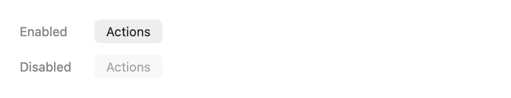

### Lazy column

SwiftUI: `ScrollView { LazyVStack { ForEach(0..<1000) { i in … } } }`

```rust
ui.lazy_col(Style::new(), 1000, |i| i, row)
```

[The block's code](https://github.com/vladkens/nimbo/blob/main/examples/gallery.rs#L445-L455)


### Scroll behavior

SwiftUI: `ScrollView { … }.scrollIndicators(.hidden).onScrollGeometryChange(…) { … }`

```rust
let b = ui.scroll_behavior(id, Axes::VERTICAL);
ui.with_id(b.thumb(Axis::Vertical)).float(at).el(thumb)
```

[The block's code](https://github.com/vladkens/nimbo/blob/main/examples/gallery.rs#L458-L480)


### Scroll indicators

SwiftUI: `NSScroller.knobStyle = .light (AppKit; SwiftUI has none)`

```rust
let red = ScrollerKnob::DARK.color(alpha(t.danger(), 0.6));
ui.set_environment(Some(red))
```

[The block's code](https://github.com/vladkens/nimbo/blob/main/examples/gallery.rs#L483-L497)

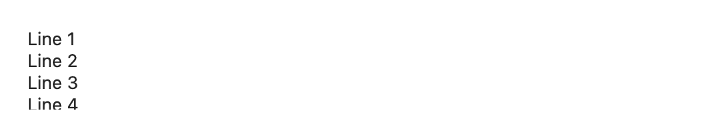

### Stack queries

SwiftUI: `Divider() follows its stack's axis (SwiftUI has no API for it)`

```rust
let (axis, n) = (ui.parent_axis(), ui.child_count());
```

[The block's code](https://github.com/vladkens/nimbo/blob/main/examples/gallery.rs#L425-L435)


## Presentation

### Alert

SwiftUI: `.alert("Delete?", isPresented: $ask) { Button("Delete", role: .destructive) }`

```rust
Dialog::new("Delete the file?").button("Delete", ButtonRole::Destructive).show(ui, &mut self.ask)
```

[The block's code](https://github.com/vladkens/nimbo/blob/main/examples/gallery.rs#L1484-L1497)


### Context menu

SwiftUI: `.contextMenu { Button("Copy") { … } }`

```rust
let menu = Menu::new(vec![Item::button(Action::Copy, "Copy"), …]);
ui.context_menu(r.id, menu)
```

[The block's code](https://github.com/vladkens/nimbo/blob/main/examples/gallery.rs#L1498-L1507)


### Menu bar

SwiftUI: `.commands { CommandMenu("Track") { Button("Play") { … } }; CommandGroup(replacing: .newItem) { … } }`

```rust
main.set_commands(&Gallery::menu_bar(), …)
```

[The block's code](https://github.com/vladkens/nimbo/blob/main/examples/gallery.rs#L1510-L1515)


### Tooltip

SwiftUI: `.help("Saves it")`

```rust
ui.help("Saves it").button("Save")
```

[The block's code](https://github.com/vladkens/nimbo/blob/main/examples/gallery.rs#L1516-L1518)


### Custom help style

SwiftUI: `.help("Saves it") (SwiftUI has no help style)`

```rust
impl HelpStyle for Note { … }
ui.help_style(&Note);
ui.help("Saves it").button("Save")
```

[The block's code](https://github.com/vladkens/nimbo/blob/main/examples/gallery.rs#L1521-L1537)


## Modifiers

### Disabled

SwiftUI: `.disabled(true)`

```rust
ui.disabled(true).button("Save")
```

[The block's code](https://github.com/vladkens/nimbo/blob/main/examples/gallery.rs#L1278-L1281)


### Control size

SwiftUI: `.controlSize(.small)`

```rust
ui.control_size(ControlSize::Small).button("Save")
```

[The block's code](https://github.com/vladkens/nimbo/blob/main/examples/gallery.rs#L1282-L1286)

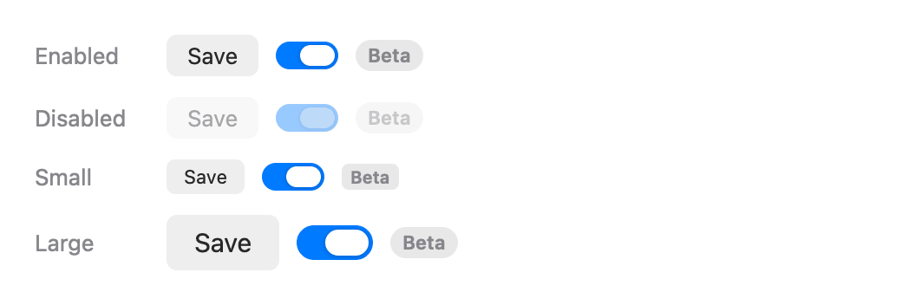

### Accessibility label

SwiftUI: `.accessibilityLabel("Reset")`

```rust
ui.a11y_label("Reset").icon_button(Icon::RESET)
```

[The block's code](https://github.com/vladkens/nimbo/blob/main/examples/gallery.rs#L1287-L1289)


### Keyboard shortcut

SwiftUI: `Button("Count") { … }.keyboardShortcut("k", modifiers: .command)`

```rust
Binding::new(Shortcut::char('k').cmd(), Command::Action("count"))
ui.keymap(KEYS).with_id(id).row(…)
if ui.command(id) == Some(Command::Action("count")) { … }
```

[The block's code](https://github.com/vladkens/nimbo/blob/main/examples/gallery.rs#L1292-L1306)

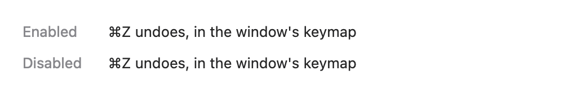

### Environment

SwiftUI: `.environment(\.tint, .green) { … }; @Environment(\.tint) var tint`

```rust
impl EnvironmentValue for Tint { … }
ui.environment(Tint(t.success())).row(row, |ui| …)
ui.environment_value::<Tint>().0
```

[The block's code](https://github.com/vladkens/nimbo/blob/main/examples/gallery.rs#L1309-L1329)


### Group

SwiftUI: `Group { Button("Save"); Toggle(…) }.disabled(true)`

```rust
ui.disabled(true).group(|ui| { … })
```

[The block's code](https://github.com/vladkens/nimbo/blob/main/examples/gallery.rs#L1332-L1338)


### Identity

SwiftUI: `Box().id(item.id); .allowsHitTesting(false)`

```rust
ui.with_id(id).row(tile, |ui| { … })
```

[The block's code](https://github.com/vladkens/nimbo/blob/main/examples/gallery.rs#L1343-L1363)


### Focus and pointer

SwiftUI: `.focusable(); .pointerStyle(.link)`

```rust
ui.focusable(true).pointer_style(Cursor::Pointer).row(tile, |ui| { … })
```

[The block's code](https://github.com/vladkens/nimbo/blob/main/examples/gallery.rs#L1366-L1378)


### Widget parts

SwiftUI: `.environment(\.isEnabled, true); .help(tip) on a part`

```rust
ui.environment(Enabled(true)).button("Undo")
let tip = ui.help("Always enabled").take_help();
```

[The block's code](https://github.com/vladkens/nimbo/blob/main/examples/gallery.rs#L1381-L1389)


### Frame request

SwiftUI: `TimelineView(.animation) { context in … }`

```rust
ui.request_frame();
let now = ui.now().as_secs_f32();
```

[The block's code](https://github.com/vladkens/nimbo/blob/main/examples/gallery.rs#L1392-L1407)


### Accessibility pair

SwiftUI: `.accessibilityLabeledPair(role: .label, id: "volume", in: ns)`

```rust
ui.a11y_labeled_pair(LabeledPairRole::Label, pair, |ui| ui.label("Volume"))
ui.a11y_labeled_pair(LabeledPairRole::Content, pair, |ui| { … })
```

[The block's code](https://github.com/vladkens/nimbo/blob/main/examples/gallery.rs#L1410-L1417)


### Controls theme

SwiftUI: `@Environment(\.controlActiveState) var state`

```rust
let c = ui.controls_theme();
```

[The block's code](https://github.com/vladkens/nimbo/blob/main/examples/gallery.rs#L1420-L1424)


### Color scheme

SwiftUI: `@Environment(\.colorScheme) var colorScheme`

```rust
ui.color_scheme().is_dark()
```

[The block's code](https://github.com/vladkens/nimbo/blob/main/examples/gallery.rs#L1427-L1431)


