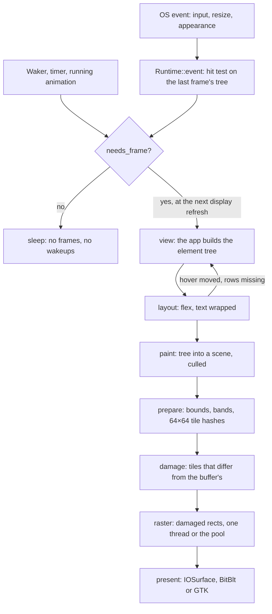

# How nimbo renders

nimbo draws every pixel of its windows itself, on the CPU. The OS gives it a window, input and text shaping, and shows the finished pixels; everything in between (the element tree, layout, painting and rasterization) is nimbo's own Rust code. This page follows one frame from the event that asks for it to the pixels on screen, with pointers into the source for each step. It describes the code as of 2026-10-31; the `//!` docs of the files named here are the reference when they disagree.

## In short

- **CPU rendering, no GPU.** A scene of quads, lines, images and glyphs is rasterized into a BGRA buffer by `src/cpu/`; the OS's compositor only shows it.
- **Immediate mode.** The app's `view` describes the whole window from its state on every frame that redraws; nimbo lays that tree out, paints it into a scene and keeps it for the next frame's hit testing.
- **Damage by tiles.** The frame is cut into 64×64 px tiles, each with a hash of everything drawn over it. Only the tiles whose hash differs from what a buffer already holds are drawn again, and only those rects are presented.
- **Threads for big damage.** Small damage is drawn on the calling thread; above 256K px the rows are shared with a pool on the performance cores.
- **The OS's text.** CoreText, DirectWrite or FreeType with HarfBuzz shape the text and rasterize each glyph once into an atlas.
- **Idle is idle.** With nothing to do a window builds no frames and has no wakeups.

## A frame, end to end



The portable half (`Runtime::frame` in `src/app.rs`, `src/ui/`, `src/cpu/`) is the same on every OS and in the headless harness; the platform half (`src/platform/<os>/`) decides when to call it and where the pixels go. The contract between them is in the docs of `src/platform/mod.rs`.

## When a frame happens

A window draws only when `Runtime::needs_frame` says so (`src/app.rs`), which is when one of these holds:

- **An event changed something.** `Runtime::event` routes it through the last frame's laid-out tree. It asks for a frame when the event was used, when the hover, press or focus changed, or when the app returned `true` from `App::event` or called `cx.redraw()`. A mouse move that changes none of these draws nothing.
- **An animation is running**: an `ui.animate` value hasn't reached its target, a spinner or a menu is moving, or `App::paint` called `f.animate()`.
- **A timer is due**: `ui.request_frame_in`, `cx.after`, a caret's next blink, the end of a flash.
- **A waker fired**: `Waker::wake` from any thread, for work done in the background.
- **The last frame asks for one more**: the window resized or an overlay opened or closed (what the view read from the last frame is a frame behind), or the glyph atlas filled up and was reset.

The platform paces these frames to the display and sleeps otherwise:

- **macOS** (`src/platform/macos/view.rs`, `link.rs`): a display link calls the view on each refresh while the runtime needs frames and is paused as soon as it doesn't. It is `CADisplayLink` on macOS 14 and later and a `CVDisplayLink` per display below 14. A timer the app asked for sleeps on the main queue and draws its one frame there, without waking the display link.
- **Windows** (`src/platform/windows/mod.rs`): the message loop sleeps in `MsgWaitForMultipleObjectsEx` until input, a wake or a high-resolution waitable timer, set to the next timer or, while something animates, to the next refresh of the window's display.
- **Linux** (`src/platform/linux/mod.rs`): frames follow GTK's `GdkFrameClock`, built after GTK's layout at the size it just gave, so a live resize never stretches. Timers are GLib timeouts.

A minimized or fully covered window draws nothing until it shows again.

## How events and wakes reach the loop

Everything runs on the main thread, in the OS's own event loop. The platform turns the OS's events into `Event`s (mouse, keys, text, input methods, scroll, focus, appearance) and hands them to the window's `Runtime`; after each one it checks `needs_frame` and unpauses its display link or schedules its timer.

The system can call back into a window from nested run loops (a file panel, a permission prompt, a context menu) while a callback up the stack is using it. A window's state is reached only through `try_borrow*`, so in that case the event waits in a queue and is delivered, in order, once the window is free; nothing is dropped.

Other threads reach the loop in two ways:

- **`Waker::wake`** (`src/app.rs`) asks a window for a frame. Wakes before the next frame coalesce into one; the first hops to the main thread (macOS: the main dispatch queue, Windows: a `WM_WAKE` message, Linux: a GLib idle source).
- **`Proxy::post` and `Proxy::after`** (`src/shell.rs`) run a closure on the main thread, inside the loop, also during modal loops. System changes such as a microphone plugged in or the lid closed (`src/system.rs`) come this way: coalesced per kind, posted to the main thread, then delivered to the app's hook and to every open window as `Event::System`, where the app returns `true` to redraw.

## The view: immediate mode

An app implements `App::view(&mut self, ui: &mut Ui)` and describes the whole window from its state, top to bottom. There is no retained widget tree to update: the state is a plain struct, and `view` reads it.

```rust
if ui.button("Add one").clicked {
  self.count += 1;
}
```

Every element gets an `Id` (its index among its siblings hashed with its parent's, or a key or name the app gives it). Input reaches the view as state: the runtime keeps the last frame's laid-out tree (`UiState.last`) and hit tests the pointer on it, so when the view builds an element again it can answer whether it is hovered, pressed, focused or was just clicked. That answer comes back as a `Response` (`hovered`, `pressed`, `focused`, `clicked`, and for text fields `changed`, `submitted`, `cancelled`, `blurred`).

State the app shouldn't hold (scroll offsets, animations, text cursors, a widget's internal state) lives in a store keyed by id (`src/ui/store.rs`). An entry lives while its id is built in each frame and is dropped after the first frame without it, unless an ancestor is kept with `ui.retain` (a hidden tab).

`view` can run more than once per frame, and between frames:

- **After a click.** `Runtime::event` runs the view once at once, without layout or paint (`Runtime::pass`), so `.clicked` is seen and the app's state changes before the next frame is built. Keys, text and input methods for the focused element are delivered through such a pass too, after the view is laid out again if an event changed it since the last frame (`Runtime::fresh`), so they see the text as it is.
- **When the layout moved the hover.** After layout the pointer is hit tested on the new tree; if the hovered element changed (content scrolled, the window resized), the view runs again so hover is never a frame behind.
- **When a virtual list shows rows it didn't build.** Its viewport grew or its offset was clamped; the view runs again on the new layout, up to three passes.

So `view` should build the tree from state and not do work that counts on running once per frame. Heavy work belongs in the app's state or on a thread, with `view` reading its result.

## Layout

`ui.layout` (`src/ui/layout.rs`) is a flex layout after [Clay](https://github.com/nicbarker/clay): widths are fitted bottom-up and distributed top-down (percent, grow by weight, shrink on overflow), text is wrapped at the final widths (`src/ui/layout/wrap.rs`), the same two passes run for heights, and then positions are placed and snapped to pixels. Scroll offsets come from the store and are clamped to the new content.

The whole tree is laid out on every frame, but the expensive part, text, is mostly looked up rather than measured:

- **Shaped lines** (`src/text/mod.rs`): each (face, text) is shaped once by the OS's text stack (kerning, ligatures, font fallback) and kept. Past 4096 lines, those the last frame didn't use are evicted.
- **Least widths and wrapped lines** (`Kept` in `src/ui/layout/wrap.rs`, over `src/text/memo.rs`): a wrapping text's least width (its widest character) and its lines broken at a given width are computed once per font and text and kept across frames. Past 4096 entries or 4 MB, a layout drops what it didn't use.

## Paint

The paint pass (`src/ui/paint.rs`) walks the laid-out tree into the frame's `Scene` (`src/scene.rs`): each box draws its shadow, background and border, then its content (text lines, an image, a canvas callback), then its children, clipped when it clips. Overlays (menus, dialogs, tooltips) follow in layers of their own, by z. A layer holds its clip and five lists drawn in order: quads, images, lines, glyphs, colour emoji. After the tree, `App::paint` draws in a layer of its own, over it.

Elements outside the window or their clip are skipped, and a long text paints only the lines whose ink reaches into the clip. The scene's buffers are cleared, not dropped, so a steady frame allocates nothing.

Glyphs are drawn from atlases (`src/text/atlas.rs`): the OS's text backend rasterizes each glyph once, at the pixel size, into an R8 coverage atlas with four horizontal subpixel positions, or into an RGBA atlas for colour emoji. New bitmaps queue as uploads, and `Renderer::sync` copies them into the renderer's atlases before the frame is drawn.

## Raster

The CPU renderer (`src/cpu/mod.rs`) draws a scene in three steps:

1. **Prepare.** Every primitive gets its pixel bounds under its layer's clip and, for a solid quad, the opaque rect it covers. It is binned into the 32-row bands it touches, and its hash (its kind, its fields, its clipped rect) is folded into the hash of every 64×64 tile it touches, in drawing order. The tiles start from a seed of the frame's size, scale and atlas generation, so a resize or an atlas reset changes every tile.
2. **Damage.** The tile hashes are compared with those of the frame the target buffer already holds. The tiles that differ are merged into disjoint rects; a buffer of another size gets the whole frame.
3. **Draw.** Only the damaged rects are cleared and drawn, band by band, in 256-px chunks. Each chunk starts at the last primitive that covers it with an opaque colour, so a panel hides what lies under it without drawing it. Coverage is computed per pixel centre and blended premultiplied into BGRA8 (`src/cpu/raster.rs`), with NEON for the blend on 64-bit ARM (Apple Silicon).

Damage up to 256K px (1/16 of a 2560×1600 frame) is drawn on the calling thread. Above that, the calling thread shares the bands with the helper threads of `src/cpu/pool.rs`, as many threads in all as there are performance cores: `hw.perflevel0.physicalcpu` on macOS, the cores of the highest efficiency class on Windows (at most 4), `/sys/devices/cpu_core` on Linux, and otherwise the cores, at most 4. The pool's threads are made on the first frame that needs them and parked on a condvar between frames, so they add no wakeups to an idle window.

A hover, a caret blink or an animated switch usually changes a few tiles; a resize, the first frame, a theme switch or a scroll of a big area redraws most of the window.

## Present

Each OS gets the pixels its own way, and each buffer keeps the tile hashes of the frame it holds:

- **macOS** (`src/platform/macos/surface.rs`): frames are drawn straight into IOSurfaces that become the view layer's `contents`, which the window server composites without a copy. A surface the window server still reads is left alone: a second, at most a third, is made, and with all three busy the frame waits. Only the tiles that changed since the frame a surface holds are drawn into it, it is set as the contents in a `CATransaction` with no animation, and nothing happens when the frame equals the one shown.
- **Windows** (`src/platform/windows/mod.rs`): one DIB section; the damaged rects are drawn into it and each is copied to the window with `BitBlt`. An overlay is shown whole with `UpdateLayeredWindow`, blended by its alpha.
- **Linux** (`src/platform/linux/mod.rs`): one cairo image surface; the damaged rects are drawn into it and each is passed to `gtk_widget_queue_draw_area`, and GTK paints them in its frame.

During a live resize the frame is drawn synchronously, so the content never stretches.

## Animations

`ui.animate(id, target, transition)` (`src/ui/mod.rs`) returns a value moving toward `target`, kept per id in the store. A `Transition` is a speed in units per second, linear or smoothstep (`Transition::smooth(6.0)` takes a hover fade from 0 to 1 in about 170 ms); a new target starts from wherever the value is.

```rust
let fade = ui.animate(id, if ui.hovered(id) { 1.0 } else { 0.0 }, FADE);
```

While any value is still moving, the frame marks itself as animating and the platform keeps drawing at the display's refresh. Each of those frames runs `view` and layout again, but usually damages only the tiles the animation touches. When every value has reached its target, frames stop.

## Accessibility

While the view builds, each behaviour records what its element is to assistive technology (role, name, value, states) by id, beside the tree (`src/ui/a11y.rs`); the records are cleared with the tree, so a frame built in several passes keeps the last pass's. They are joined to the laid-out nodes only when asked.

On macOS (`src/platform/macos/a11y.rs`) nothing runs until an assistive client such as VoiceOver asks the view for its children, its focus or a hit. From then on the view takes a snapshot after each frame, diffs it against the last and posts only the notifications for what changed. Windows and Linux build the same model, with no adapter to the OS yet.

## What is kept between frames

| What | Kept? | Where |
| --- | --- | --- |
| Element tree | Rebuilt each frame into reused buffers; the last laid-out tree is kept for hit testing, keys and input methods | `UiState` in `src/ui/mod.rs` |
| Per-element state (scroll, animations, carets, widget state) | Yes, by id, while the id is built or retained | `src/ui/store.rs` |
| Layout positions and sizes | No: the whole tree is laid out each frame | `src/ui/layout.rs` |
| Shaped text lines | Yes, per face and text | `src/text/mod.rs` |
| Least widths and wrapped lines of texts | Yes, per font, text and width | `src/ui/layout/wrap.rs`, `src/text/memo.rs` |
| Glyph bitmaps | Yes, in the coverage and colour atlases | `src/text/atlas.rs`, `src/cpu/mod.rs` |
| Scene | Rebuilt each frame into reused buffers; not diffed as a structure, the tile hashes are its diff | `src/scene.rs`, `src/cpu/mod.rs` |
| Pixels | Yes: each buffer keeps its pixels and their tile hashes, so unchanged tiles are never drawn again | the present paths above |
| Rasterized subtrees or layers | No | |

## Limits

- **The cost follows what `view` builds, not what changed.** Every frame that redraws runs `view` and lays out the whole tree, so content that is built but off screen costs on every frame, a hover tick included. Long content belongs in the containers that build only what is in view: `ui.list` / `List` (`src/ui/containers/list.rs`), `ui.virtual_col` (`src/ui/containers/lazy.rs`) and `ui.form_list` (`src/ui/form.rs`). A form of 500,000 rows takes about 0.4 ms of view and layout per frame on an M2.
- **A scroll or resize frame often runs `view` twice**: when the elements under the pointer change with the new layout, the view runs again.
- **No subtree caching**: there is no way yet to keep a static part of the tree laid out across frames.
- **No GPU path yet.** A full repaint (a resize, the first frame, a scroll of a big area) costs in proportion to the pixels, which on a large high-DPI screen or a slow CPU is where a frame gets tight. A scroll redraws the scrolled area rather than moving the pixels already drawn. A Metal renderer behind the same scene is a possible future, not planned work.
