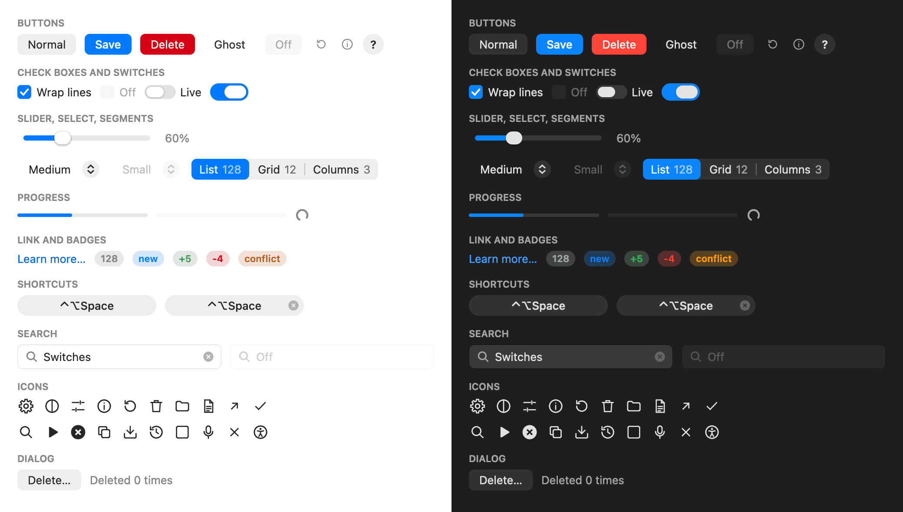

<div align="center">


**A small, fast desktop UI toolkit for Rust, with one look on macOS, Windows and Linux**

[](https://crates.io/crates/nimbo)
[](https://docs.rs/nimbo)
[](https://github.com/vladkens/nimbo/blob/main/LICENSE)
[](https://x.com/uid127)

</div>

`nimbo` draws its own widgets, in the look of macOS System Settings, and leaves the rest to the system: the window to AppKit, Win32 or GTK, the text to CoreText, DirectWrite or FreeType with HarfBuzz. It draws on the CPU, with no GPU stack to build or start, and pulls in a handful of crates. Besides windows it has what a menu bar app needs: a tray icon, global hotkeys, overlays over other apps and launch at login.

<div align="center">
  
</div>

## Features

- 🎨 **One look everywhere.** Widgets drawn by nimbo, the same on every OS, light or dark and in the accent colour the system has.
- 🔤 **The system's own text.** Native shaping and fonts, font fallback, colour emoji, subpixel positioning and input methods (Pinyin, Japanese) composing in place.
- 🪶 **Small.** 13 dependencies on macOS (keyboard-types and the objc2 family), 4 on Windows (windows-sys in place of objc2), 2 on Linux, where GTK and the text libraries load at run time and nothing is linked. The counter example builds from scratch in 10 s (release, M2) into a 1.1 MB binary.
- ⚡ **Repaints only what changed.** Frames keep to the display's refresh, and a still window sleeps until something happens.
- 🧩 **Widgets.** Buttons, check boxes, switches, sliders, selects, segmented controls, text fields, search fields, progress bars, badges, tooltips, icons and a shortcut recorder; virtualized lists, menus, tabs, split views and scroll areas; a settings form and a modal dialog.
- 📐 **Layout in code.** The view is built every frame as a tree with flex and grid layout; nimbo keeps each element's state (focus, hover, scroll, animations) by its id.
- 🛎️ **Menu bar apps.** An app without a window that opens windows on demand, a tray icon with a menu, global hotkeys (a modifier key alone too), HUD overlays that never take the focus, launch at login, the app's folders and alerts.
- 🔗 **Other apps.** Open links and files, reveal them in the file manager, check macOS permissions, see which app has the focus, post a shortcut to it, and paste through the clipboard and put it back.
- 🧪 **Headless.** Any app renders to a PNG without a window, and tests drive it with clicks, keys and virtual time, then check its state and pixels.

## Platforms

- **macOS 14** or later. Build apps with `MACOSX_DEPLOYMENT_TARGET=14.0`, as this repository does in [`.cargo/config.toml`](.cargo/config.toml).
- **Windows 10 1809** or later. Put `#![cfg_attr(windows, windows_subsystem = "windows")]` at the top of `main.rs`, as the examples do, so that no console opens next to the window.
- **Linux** on Wayland or X11 with GTK 3 (`libgtk-3.so.0`), fontconfig, FreeType and HarfBuzz, all loaded at run time. A tray icon needs a panel that hosts StatusNotifierItems (KDE Plasma, Xfce, LXQt, Cinnamon, MATE; GNOME with the AppIndicator extension), global hotkeys the GlobalShortcuts portal (KDE, GNOME 48+, Hyprland). On Wayland an overlay sits at its anchor above other windows through `libgtk-layer-shell` (wlroots compositors, KDE); without it (GNOME) the compositor places it as any window.

## Usage

```sh
cargo add nimbo
```

```rust
use nimbo::{App, Config, Font, Id, Style, TextStyle, Ui};

#[derive(Default)]
struct Counter {
  count: i64,
}

impl App for Counter {
  fn view(&mut self, ui: &mut Ui) {
    let t = ui.theme();
    ui.col(Style::new().grow().center().gap(12.0).bg(t.bg), |ui| {
      ui.text(self.count, TextStyle::new(Font::ui(48.0), t.text));
      if ui.id("plus").button("+1").clicked {
        self.count += 1;
      }
    });
  }
}

fn main() {
  // `cargo run` opens a window; `cargo run -- --shot counter.png` renders it headless instead,
  // after this script: a frame and a click on +1.
  nimbo::run(Config::new("Counter", 320.0, 240.0), Counter::default(), |h| {
    h.frame();
    h.click_id(Id::of("plus"));
  });
}
```

`nimbo::run` opens a window, or with `--shot <file.png>` renders the app in the harness instead: dark unless `--appearance light`, at the window's size unless `--size <w>x<h>`, at `--scale 2` by default. Tests drive the same harness:

```rust
#[test]
fn plus_counts() {
  let mut h = nimbo::Harness::new(Counter::default(), nimbo::Size::new(320.0, 240.0), 2.0);
  h.frame();
  h.click_id(Id::of("plus"));
  assert_eq!(h.app().count, 1);
}
```

An app that lives in the menu bar starts with `nimbo::app` instead: it opens windows when it needs them (`Main::open`), shows a tray icon (`nimbo::tray`) and listens to global hotkeys (`nimbo::hotkey`), as the [tray](examples/tray.rs) example does. The [API docs](https://docs.rs/nimbo) have the rest.

## Examples

```sh
cargo run --release --example gallery                     # in a window
cargo run --release --example gallery -- --shot out.png   # or headless, to a PNG
```

| Example | What it shows |
|---|---|
| [`gallery`](examples/gallery.rs) | Every widget, in the light and the dark theme side by side |
| [`settings`](examples/settings.rs) | A settings window in the System Settings look: toolbar tabs over pages of grey plates |
| [`counter`](examples/counter.rs) | Buttons and a count: hover, press, Tab focus |
| [`lists`](examples/lists.rs) | A virtualized list of 100,000 rows beside tabs in a split, menus and a scroll area |
| [`fields`](examples/fields.rs) | Text fields, a password, notes over several lines, selectable text, input methods |
| [`text`](examples/text.rs) | System fonts: sizes and weights, Cyrillic, accents, emoji, CJK, subpixel positioning |
| [`shapes`](examples/shapes.rs) | The drawing primitives: rounded rects, borders, shadows, gradients, images, lines, clips |
| [`input`](examples/input.rs) | Dragging, the wheel, arrow keys, cursors and the clipboard |
| [`tray`](examples/tray.rs) | A tray app with no window of its own: a menu, a global hotkey, launch at login |
| [`hud`](examples/hud.rs) | An overlay over every app that never takes the focus: a recording pill |
| [`pace`](examples/pace.rs) | Frame pacing, measured by `make pace` |

## How it's made

nimbo is written by AI agents (Claude Code, Codex) following [agents.md](agents.md); I choose what to build and review every pull request. The examples are tested headless down to their pixels, each part of the code has a size budget that CI checks (`make size`), and frame pacing is measured on each backend whose event loop a change touches (`make pace`). nimbo is young: the API will change before 1.0, and screen readers aren't supported yet.

## License

Distributed under the [MIT License](LICENSE).

## See also

- [egui](https://github.com/emilk/egui) – Immediate-mode GUI on the GPU, also for the web.
- [iced](https://github.com/iced-rs/iced) – Elm-inspired GUI with a GPU and a CPU renderer.
- [GPUI](https://github.com/zed-industries/zed/tree/main/crates/gpui) – Zed's GPU-accelerated UI framework.
- [Slint](https://github.com/slint-ui/slint) – Declarative GUI with its own markup language, for desktop and embedded.
- [Tauri](https://github.com/tauri-apps/tauri) – Desktop apps with a web UI in the system's webview.
