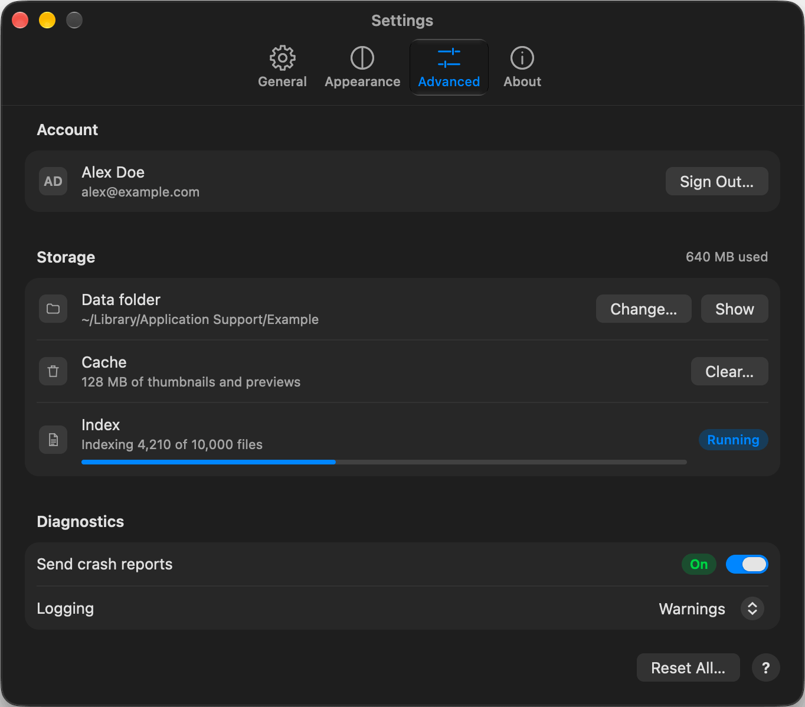

<div align="center">


**A small, fast, custom-drawn desktop UI toolkit for Rust**

[](https://crates.io/crates/nimbo)
[](https://docs.rs/nimbo)
[](https://github.com/vladkens/nimbo/blob/main/LICENSE)
[](https://x.com/uid127)

</div>

`nimbo` is a desktop UI toolkit for Rust that draws every widget itself, on the CPU, over a thin native layer for the window, the input and the text: AppKit and CoreText on macOS, Win32 and DirectWrite on Windows, GTK 3 with FreeType and HarfBuzz on Linux. The look follows macOS System Settings, measured from its screenshots, in light and dark. A settings window, a tray app or a HUD takes a few hundred lines and 13 crates, and the whole toolkit builds from scratch in about 10 seconds.

## 🌟 Features

- 🖌️ **One look on three systems**, measured from macOS System Settings, in light and dark and the system's accent colour
- 🔤 **The system's text stack**: CoreText, DirectWrite or FreeType with HarfBuzz shape the text and rasterize each glyph once into an atlas; subpixel positioning, colour emoji, input methods
- 🖥️ **A CPU renderer**: draws the whole window, the glyphs from that atlas too, and hands the frame to the system's 2D path (an IOSurface, a GDI bitmap, a cairo surface); no GPU API, shaders or drivers; frames paced to the display, an idle window asleep
- 🧩 **Widgets as headless behaviours** plus a theme: buttons, switches, fields, selects, tabs, splits, dialogs, lists and form pages of 500k rows built in view only; or your own look over the same behaviour, read by VoiceOver either way
- 🛎️ **Tray and HUD apps**: a tray menu, global hotkeys, launch at login, overlays that never take the focus, the system's permissions
- 📂 **Files**: the system's open and save panels, files dragged onto a window
- 🧪 **A headless harness**: every example renders to a PNG without a window; tests click, type and check pixels and what a screen reader reads, in parallel
- 📦 **13 crates on macOS, 4 on Windows, 2 on Linux**: GTK is loaded at run time, nothing to link

<div align="center">
  
</div>

## 🧭 Why nimbo

nimbo grew out of [wavo-app](https://github.com/vladkens/wavo-app), the dictation app I use about 400 times a day. I wanted it to take little memory, react fast and run as one process, with no Electron or webview:

- **Tauri** (Handy, the app it replaces): **565 MB** at idle.
- **GPUI**, directly and through GPUI Kit: a decent base, but a zoo of dependencies (**465 crates** for the UI alone, **619** with the Kit) and slow rebuilds.
- **egui**: the best of the two, lighter in binary and memory, but hard to customise and far from native.
- **Native controls on each system**: the lightest on memory, but the controls differ everywhere, the design came out different on each system, and every feature was written three times.
- **The Sublime Text and Sublime Merge way**: a small UI I draw myself over the system's window, input and text. The middle ground, and this library came out of it.

I keep nimbo small on purpose: a core of windows, input, text, layout, a renderer and the widgets a desktop app needs, and nothing bundled that most apps don't use (no Markdown or HTML renderer, charts, code editor, dock system or scripting runtime). That limits the library, not the apps: anything bigger is built on the same core, in the app or as an add-on.

## 📥 Installation

nimbo isn't released yet; take it from git:

```sh
cargo add nimbo --git https://github.com/vladkens/nimbo
```

<details>
<summary>Requirements per OS</summary>

- **macOS** 11 or later: rustc's default deployment target, so an app sets nothing.
- **Windows**: `#![cfg_attr(windows, windows_subsystem = "windows")]` in `main.rs`, so no console opens with the window.
- **Linux**: GTK 3 at run time (every desktop has it), on Wayland or X11. Overlays on Wayland need `libgtk-layer-shell`, the tray icon a panel with StatusNotifierItems, file panels the desktop's portals (GNOME, KDE), and on Wayland hotkeys and a paste into another app the portals too (X11 grabs the hotkey and types with XTest).

</details>

## 🚀 Usage

An app builds its frame as an element tree in `view`, and reads clicks where it builds the buttons:

```rust
use nimbo::{App, Config, Font, Style, TextStyle, Ui};

#[derive(Default)]
struct Counter {
  count: i64,
}

impl App for Counter {
  fn view(&mut self, ui: &mut Ui) {
    let t = ui.theme();
    ui.col(Style::new().grow().center().gap(16.0).bg(t.bg), |ui| {
      ui.text(self.count, TextStyle::new(Font::ui(48.0), t.text));
      if ui.button("Add one").clicked {
        self.count += 1;
      }
    });
  }
}

fn main() {
  nimbo::run(Config::new("Counter", 320.0, 240.0), Counter::default(), |_| {});
}
```

`nimbo::run` opens the window; `-- --shot counter.png` renders it to a file without one.

### How a frame is built

The API is immediate-mode, like egui: `view` builds the whole tree from the app's state, and a widget answers right where it's built. There are no signals, no `Rc<RefCell>` and no message enums: the state is a plain struct, a switch gets `&mut self.field`. What keeps the cost down:

- **`view` runs only on frames that redraw**: after input, during an animation, when a timer is due. An idle window runs and draws nothing.
- **What lives between frames**: the last laid-out tree (for hit testing), each widget's own state by its id (scroll, focus, caret, animations), shaped text and its wrapped lines.
- **Long content is built in view only**: a form of 500,000 rows takes about 0.4 ms of view and layout per frame on an M2.

It suits settings windows, tray and HUD apps and tools with long lists. A change runs the whole `view` again, where a reactive toolkit (SwiftUI, Xilem) would rebuild one branch. So heavy work belongs in the app's state or on a thread, and `view` only reads its result.

### How it draws

nimbo renders on the CPU, with no GPU path yet: the frame is cut into 64×64 px tiles, each hashed by what is drawn over it, and only the tiles that changed are drawn again (on the performance cores when many did); Windows and Linux copy only those to the window. [docs/rendering.md](docs/rendering.md) follows a frame step by step.

### Examples

```sh
cargo run --release --example gallery                          # every widget, light and dark side by side
cargo run --release --example gallery -- --shot gallery.png    # the same, rendered without a window
```

- `counter`: buttons, hover, focus
- `gallery`: every widget, light and dark
- `settings`: a macOS-style settings window
- `files`: open and save panels, drag and drop
- `lists`: a list of 100,000 rows, menus, tabs, a split
- `history`: 86,000 rows a day at a time in a form, built in view only
- `fields`: text fields and input methods
- `text`: fonts, scripts, emoji
- `shapes`: what the renderer draws
- `input`: mouse, keys, clipboard
- `tray`: a tray icon, a global hotkey
- `hud`: an overlay over every app

## 📏 Size

Measured on an Apple M2, rustc 1.99, 2026-10-25, without a compiler cache:

- **10.1 s** a clean release build of the `counter` example (8.3 s debug)
- **1.1 MB** its release binary (0.87 MB stripped)
- **13 / 4 / 2** crates in the build on macOS / Windows / Linux, nimbo excluded

## 🙏 Credits

- [dwrite-hlsl](https://github.com/lhecker/dwrite-hlsl) (MIT): DirectWrite's gamma ratios, used to blend text on Windows.

## 🔍 See also

- [zed-industries/zed](https://github.com/zed-industries/zed) – GPUI, the GPU-drawn toolkit of the Zed editor.
- [emilk/egui](https://github.com/emilk/egui) – An immediate-mode GUI in Rust, for the web and native.
- [iced-rs/iced](https://github.com/iced-rs/iced) – A cross-platform GUI library in Rust, inspired by Elm.

## 🗺️ Roadmap

- **0.1.0**: what nimbo has today
- **Next**: translations (i18n with plural forms) and right-to-left layout (Arabic, Hebrew); more widgets, after SwiftUI's set (steppers, date pickers, disclosure groups)
- **Later**: a Metal GPU renderer on macOS

## 🤖 How it's made

nimbo is written by AI agents (Claude Code, Codex) following [agents.md](agents.md); I choose what to build and review every pull request. I check every visual change in a shot. I've written software by hand for years ([macmon](https://github.com/vladkens/macmon), [twscrape](https://github.com/vladkens/twscrape), [ecloop](https://github.com/vladkens/ecloop)); agents are how I build now. Releases are rare; the CLI and data formats stay compatible, the API may still change before 1.0, and every break is listed in the changelog.

## 🤝 Contributing

Pull requests are welcome, including ones made with agents: point yours at [agents.md](agents.md).

## 📝 License

Distributed under the [MIT License](LICENSE).
